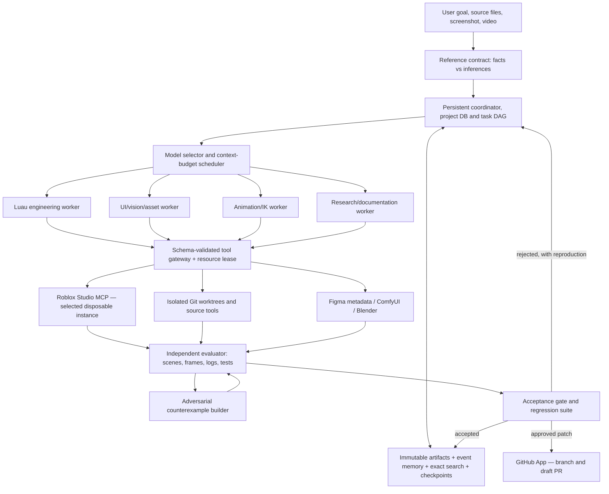

# STAR FRONTIER LAB — Volume II: Research-Driven Intelligence Engineering

**Research date:** October 9, 2026  
**System:** STAR, a local-first, multimodal, agentic Roblox-development platform  
**User hardware:** Windows 11; NVIDIA RTX 3060 Ti, typically 8 GB VRAM; 32 GB DDR4 system RAM  
**Research question:** What concrete engineering and research investments would make STAR reliably outperform a general-purpose assistant in *Roblox-development workflows*, using a limited local GPU and an autonomous GitHub development process?

> **Status and scope:** This is a research synthesis and experimental specification. The accompanying repository contains working offline scaffolding for local-model calls, project memory, GitHub App operations, an evaluation *catalog*, and an independently testable candidate-comparison function. It is **not** a trained superintelligence, a demonstrated frontier-model rival, an independent research breakthrough, or a completed Roblox playtest platform. All proposed outcomes below require controlled measurements before they become claims.

## The answer in one page

STAR's largest near-term advantage is not a novel foundation model. It is a **domain-specific execution system** that uses *actual Roblox project state, real runtime feedback, specialized asset tools, reliable saved knowledge, controlled experimentation, and verified code delivery*. A general assistant may know a great deal about Roblox, but STAR can be optimized around the exact target environment and tasks—if we build the required sensors, action tools, evals, and recovery mechanisms.

The strongest research path combines six findings:

1. **Evolve solutions using objective evaluators:** DeepMind's AlphaEvolve [R01–R02] demonstrates a productive generate → evaluate → select → iterate architecture. We propose a narrower, reproducible Roblox implementation and will measure whether iterative variants improve game-development outputs.
2. **Let a verifier discover new failures:** The 2026 ICML Agentic Verifier work [R03] finds discriminating test inputs rather than settling for shallow existing tests. STAR should generate counterexamples for Roblox inventory, networking, animation, and UI logic, then confirm them with a separate trusted evaluator.
3. **Scale work by carefully reusing attempt summaries:** 2026 agentic-coding research [R04] reports benefits from compact structured representations of prior solution trajectories. On an 8 GB GPU, this is more practical than keeping huge live contexts or running many large models simultaneously.
4. **Evolve instructions before expensive fine-tuning:** GEPA [R05–R06] offers reflective prompt optimization guided by actual feedback. STAR can test candidate strategies on holdout Roblox tasks; the selected strategy remains a versioned configuration rather than an unreviewed self-modification.
5. **Learn from verified environment interaction:** SWE-Gym and Agent Lightning [R07–R08] explore training agents from executable task environments and agent trajectories. Training should begin *after* STAR can collect accurate evidence, with modest adapters rather than training a frontier model on this machine.
6. **Use the engine's structural truth:** Roblox's built-in MCP server [R09] exposes scripts, objects, screenshots, playtesting, input, and generation. Its adaptive UI styling [R10], procedural models [R11], animation/IK systems [R12], and testing modes [R13–R14] give STAR domain-specific information that a screenshot-only model does not have.

**Fundamental design principle:** `Instructions → structured plan → sandboxed action → measurable observation → counterexample search → verified acceptance → retained knowledge`.

### Research evidence versus STAR proposals

| Finding or proposal | Origin | Confidence | What remains unproven for STAR |
|---|---|---|---|
| Evolutionary search with automated evaluators can improve algorithms | Published AlphaEvolve research [R01] | High that this approach has demonstrated external results | Whether it works for small-model Roblox tasks under 8 GB VRAM |
| Active test generation can discriminate candidate code | ICML 2026 study [R03] | High for the studied programming problems | Effect size on Roblox stateful client/server code |
| Better tool interfaces help coding agents | SWE-agent / ACI study [R15] | High for studied repo tasks | Exact best tool interface for Studio and Luau |
| Long-context summary alone is not sufficient for long projects | Anthropic harness experience [R16] | High as reported engineering experience | Our own task resume success rate |
| Dedicated memory can trade accuracy against cost | LeanMem and 2026 memory comparisons [R17–R18] | Medium, task-dependent | Actual benefit to STAR's project facts and image references |
| Multi-agent research can beat one agent on broad searches | Anthropic 2025 study [R19] | High for their internal tasks, not universal | Whether parallelism helps Roblox editing on one GPU |
| STAR can beat GPT/Claude on specific Roblox workflows | STAR hypothesis | **Not demonstrated** | Requires a fair head-to-head test with the same allowed tools and test fixtures |

## I. Define precisely what “more intelligent than ChatGPT or Claude” means

The broad claim “STAR is smarter than all general-purpose models” would require an independent evaluation of general reasoning, scientific discovery, coding, multimodality, safety, and transfer across domains—something this local prototype cannot establish. It is also a poor product objective. Instead, build a testable **Roblox systems advantage**:

* **Instruction fidelity:** Given a reference and corrections, STAR preserves what was approved and changes only what was requested.
* **Code validity:** The generated Luau satisfies strict typing where appropriate, passes engine integration tests, and handles malicious or invalid client inputs.
* **Functional success:** The right objects/scripts/animations exist in the live selected test place and behave correctly across realistic device/network conditions.
* **Visual fidelity and editability:** UI and models actually match their approved references while remaining native and editable.
* **Reliability under duration:** A task can cross context compactions and Windows restarts without losing accepted decisions, duplicating operations, or damaging unrelated files.
* **Autonomous iteration:** STAR can find a failure, reduce it, revise its implementation, and demonstrate that both the initial failure and general regressions are resolved.
* **Resource efficiency:** On this hardware, measure accepted tasks per hour and per GPU-second, not raw tokens, agent count, or model parameters.

### Rigorous comparison protocol

Give STAR and the comparison assistant the same full task, same reference assets, equal access to a disposable Roblox place and documentation, and a common **outside-of-model test runner**. Equalize the relevant task budget (wall time, tool calls and/or compute cost; report each separately). Do not let either system edit its grader or obtain hidden reference fixes. Test multiple seeds/trials and independently review aesthetics.

Measure **end-state correctness**, not whether the model declares success. For fair attribution, keep two scores: *model alone* on code/visual reasoning, and *complete system* with tools/agent harness. This separates genuine model reasoning gains from the engineering benefits STAR gains through superior Roblox-specific integration. SWE-Bench Pro V2's September 2026 release is particularly instructive: its maintainers repaired flawed tasks, locked evaluation, regraded diffs on clean images, and addressed contamination from fix commits [R20].

A successful STAR benchmark might read: *“On a fixed held-out set of 20 Roblox UI-and-code tasks, STAR completed X, assistant baseline completed Y, using these exact models, tools, hardware budgets, grading rubrics and confidence intervals.”* X and Y must be **measured**, never invented.

## II. The STAR-FORGE architecture



### Core boundaries

**User-facing application:** Local React/TypeScript UI and Python service can display conversation, uploaded references, real actions, task graph, logs, image/animation previews, git diffs and results. A native desktop shell can come later. Don't build the final theme before we have one complete working use case.

**Project coordinator:** SQLite with write-ahead logging and atomic transactions for project metadata, task journal, resource ownership, evidence pointers and versioned user decisions. Files and image assets remain content-addressed on disk; only pointers and metadata are in SQLite.

**Model router:** Start with LM Studio or Ollama, both replaceable. Model-selection decisions and configured context must be recorded per task. The same GPU may service several logical workers serially; their “parallelism” means independent jobs/contexts, not guaranteed simultaneous inference.

**Gateway:** Discover each MCP server's real tool schemas at runtime; validate arguments, enforce selected Studio ID and allowed instance/repository scopes, audit actions, and serialize mutations on one shared Studio instance. Treat `execute_luau` as broad trusted-code execution, not as a path-restricted harmless edit. For dangerous operations use a disposable place or stricter executor; prompt text is not a security boundary.

**Source-first development:** Maintain source files in Git and use Rojo/sourcemaps for reproducible Luau changes; inspect the live Studio DataModel separately to reconcile generated/editor-owned assets. Avoid two owners of the same object or a sync process quietly undoing Studio edits.

**Verification authority:** The independent evaluator is not authored by the worker being graded. Required test cases and acceptance logic live in read-only fixtures and are executed from a clean baseline revision. Its input artifacts must be linked to the candidate's actual commit, place snapshot and tool log.

### Task state machine

`QUEUED → GROUNDED → PLANNED → READY → RUNNING → PROPOSED → VERIFYING → {ACCEPTED | REPAIRING | BLOCKED | REJECTED}`

Each task stores `project_id`, `task_id`, `baseline_commit`, `source/place snapshot ID`, `approved_reference_hashes`, `owned_paths`, `read-only_dependencies`, `tool_permissions`, `run_budget`, `evidence_records`, `review_status`, `next_action`, and `mutation_operation_ids`. Recovery checks the actual current state before repeating an operation. A timed-out push or asset upload might already have succeeded.

### Why “a swarm of 50 agents” is not the first breakthrough

Anthropic's 2025 multi-agent research discussion reports benefits on breadth-first research and notably higher token usage, while cautioning that many coding tasks are strongly interdependent [R19]. With one 8 GB GPU, deploy one primary model and at most a few logical specialist contexts initially. Use independent research and file inspection in parallel; serialize shared Studio mutations. Add workers only after paired evaluation shows more accepted work per hour.

## III. Getting stronger performance from an 8 GB GPU

### Hardware-aware inference

The RTX 3060 Ti typically has 8 GB VRAM. Qwen3.5 4B is currently listed around 3.75 GB in LM Studio and 3.3–4.0 GB across Ollama tags [R21–R22]. The Qwen3.5 9B GGUF variant is listed near 7 GB and is worth *experimenting* with, but runtime memory includes additional context/KV cache, multimodal components and operating-system/GPU allocations. A nominal 256K context window is **not** an appropriate initial local configuration.

First compare Qwen3.5 4B (primary multimodal baseline), Qwen3.5 9B (offload experiment), and one code-centric baseline against identical Roblox tasks. Try 4K, 8K and 16K active contexts with exact peak VRAM/RAM/latency measurement. Larger models might complete fewer useful tasks per hour due to slow CPU offloading. Don't turn a download size into a memory or speed guarantee.

Recommended model runtime policy: `localhost-only`, no secret cloud fallback, explicit enablement for network tools, and unload or park the language model before heavy image diffusion. `llama.cpp` supports CUDA, quantization and partial GPU/CPU offloading [R23]. LM Studio and Ollama provide convenient model management and local serving. The correct winner must be chosen by measured outcomes, not slogans.

### Allocate extra reasoning only when likely to pay off

Instead of always generating a long response, use **difficulty-aware attempt budgets**:

| Difficulty | Default STAR strategy | Escalation condition |
|---|---|---|
| Small, well-specified edit | One attempt, linter/type check, focused regression | A real test fails |
| Moderate feature | Inspect affected code + planned edits + test/refine | First attempt fails or dependencies are unclear |
| Complex multiplayer/animation/UI | Structured plan + up to several diverse candidates + independent verifier | Candidate conflicts, visual mismatch, safety violations |
| Novel research/optimization | Candidate pool + measured objective + external holdout | More exploration demonstrably improves quality per compute |

The 2026 *Scaling Test-Time Compute for Agentic Coding* paper emphasizes selecting and reusing concise summaries of long agent trajectories [R04]. A separate Google study on cost-effective agent scaling emphasizes tool-call cost as well as token cost [R24]. These motivate an adaptive scheduler: after initial failure, spend compute on **counterexample discovery or better context retrieval** before blindly generating five similar solutions.

### Implement an agent-computer interface (ACI) designed for the model

SWE-agent's work [R15, R25] found that specialized viewing/editing tools and concise feedback could materially improve performance. For STAR, implement narrow operations such as:

```text
find_symbol(name, project_id) → typed references and file ranges
read_module(path, start_line, max_lines) → numbered source excerpt
get_instance(path, properties=[...]) → structured DataModel snapshot
find_event_handler(remote_name) → callers, validators, rate-limit points
capture_gui_state(viewport, mode, state_name) → image + native rectangles
inspect_rig(rig_id) → joint tree, attachment frames, clip list
simulate_click(target_instance, expected_state) → action log + evidence
propose_patch(paths, unified_diff, expected_sha) → patch artifact only
execute_test(case_id, candidate_commit, isolated_place_id) → evidence pointer
```

These are **proposed STAR gateway APIs**, not promises that Roblox's MCP server offers these exact signatures. They wrap native MCP calls, file tools and instrumented scripts while hiding unnecessary tool complexity from small models.

## IV. Multimodal understanding: screenshots, videos, code and true geometry

The AI must be shown *the actual media*, not just a filename or the previous agent's paraphrase. An uploaded reference has a content hash, project scope, original dimensions, explicit user annotation and approved/rejected/superseded state. When a fresh subagent is delegated, the coordinator must supply the original authorized image bytes or a supported multimodal tool result. Do not assume the parent agent's private visual context automatically transfers.

### Reference Contract — the missing intermediate representation

STAR converts ambiguous natural language and visual references into a small, versioned contract:

```json
{
  "project": "example-roblox-game",
  "goal": "Rebuild the approved inventory interface",
  "sources": [
    {"sha256": "actual-hash", "role": "approved-layout", "approved": true},
    {"sha256": "actual-hash", "role": "icons-and-button-style", "approved": true}
  ],
  "observed": ["Two-column item grid", "Title aligned with panel start"],
  "required": ["Native GUI, not one flattened texture", "Maintain approved silhouette"],
  "inferred": ["Hover animation appears likely but cannot be proven from still"],
  "unknown": ["Exact font metadata", "Tablet interaction behavior"],
  "protected_paths": ["game.StarterGui.HUD.Score"],
  "acceptance": ["Touchable and keyboard controls work", "No clipped labels on target devices"]
}
```

The `observed/inferred/unknown` distinction prevents a small vision model's inaccurate spatial estimates from becoming immutable project requirements. Original images remain retrievable; the contract is not a replacement for them.

### Proposed structural-visual fusion

**Three independent observations** should jointly ground UI and world edits:

1. **Vision observation:** Screenshot content, composition, appearance, silhouette, apparent misalignments. Useful for artistic intent, not exact layout measurement.
2. **Engine structural observation:** Full instance paths, object class, parent hierarchy, AbsolutePosition/AbsoluteSize (when meaningful in context), visible/active/interactable state, animation joint/attachment metadata, source file mappings, object bounds.
3. **Behavior observation:** Simulated input, transitions, test results, frame timings, actual multiplayer authority, evidence from device and network simulation.

If all three agree, STAR has considerably more evidence than image-only analysis. If the screenshot suggests the button exists but the hierarchy shows a non-interactive ImageLabel and simulated input does nothing, STAR should diagnose a structural or behavior issue—not alter a random color.

### Image-to-UI work must be editability-first

Roblox UI supports engine-level StyleSheets, tokens, conditional StyleQuery rules and a built-in Style Editor [R10, R26]. Instead of generating thousands of fixed pixel offsets, produce a design-token file and declarative component tree. Use `UIListLayout`, `UIGridLayout`, `AutomaticSize`, `UISizeConstraint`, `UIAspectRatioConstraint`, appropriate anchors and safe areas where beneficial [R27]. Capture identical states at a set of device profiles [R28]; inspect rect overlap, clipping, text fit and click targets alongside screenshots.

When an actual editable Figma file exists, structured Figma MCP data [R29] supplies typography, component, layout and variable information that a screenshot cannot reveal. Import the design specification, not just its raster preview. Figma support can be optional because STAR's local-first path should not require a particular commercial design account.

### Motion and video references

A motion reference needs frame timing. Sampling a 30 fps action at one frame per second could miss a hit contact, foot plant or transition. Save timestamps and sample more densely around relevant actions. Video evidence remains distinct from an editable rig animation. For hidden geometry, use multiple approved angles or a real skeleton; one still image cannot reconstruct unknown surfaces reliably.

**Exact acceptance signals for animation** should include joint and attachment positions, foot contact drift, root movement, loop pose/velocity difference, action marker timing, blend weights, collision/silhouette from multiple cameras and normal-speed playback. Choose task-specific tolerances based on the rig, art style and intended motion. A random “95/100 animation beauty score” is neither rigorous nor useful.

## V. Roblox coding as a separate intelligence discipline

Deep Luau ability is more than generic Lua syntax. Roblox's client/server architecture, network replication, lifecycle, scheduling, data stores, character controllers, user interface engine and security model require explicit reasoning. Its official client/server security guidance says critical client input must be validated server-side, including type, context, permissions, rate and numeric edge cases [R30].

### Mandatory engineering workflow

1. **Ground:** Read current repository structure, type annotations, dependency tree, relevant scripts, remote event contracts, accepted decisions, and Studio DataModel.
2. **Plan:** State the intended invariants, threat model, lifecycle assumptions and changed files/objects. Separate server authority from client presentation.
3. **Implement:** Prefer maintainable, strict Luau (`--!strict` when appropriate), reused modules and named interfaces. Avoid global changes and implicit source edits that Rojo will overwrite.
4. **Static verification:** Format with StyLua, lint with Selene, use Luau LSP/Studio diagnostics, inspect source references. These can detect mistakes but do not prove behavior.
5. **Behavior verification:** Run tests for joined/disconnected players, respawns, dropped packets, latency, invalid remotes, duplicated rewards, reentrancy, collisions and persistence failures.
6. **Independent adversarial check:** A testing worker constructs new attempts to violate invariants. This is where agentic-verifier research is relevant [R03, R31].
7. **Patch acceptance:** On a clean baseline, make sure the targeted failure is fixed and protected behavior has not changed. Evidence must belong to the actual commit and selected place instance.

### Domain-specific code analyzers to build

* **Remote contract extractor:** Map each RemoteEvent/RemoteFunction to producer scripts, server handler, validation, rate limiting and state changes. Flag client-trusted currency/damage/permission paths; propose repro tests, not only pattern matches.
* **Lifecycle analyzer:** Track connections and cleanup across character respawn, teleport, player leaving and server shutdown. Detect listeners connected multiple times and missing disconnect/Destroy paths.
* **Resource ownership graph:** Identify scripts that write a shared piece of state; prevent separate agents from editing incompatible modules and prevent user updates from being overwritten.
* **Finite-value/bounds test generator:** Generate NaN, infinity, zero, negative and out-of-range inputs for economy and physics. (Don't deploy exploit code to other people's servers; use owned test places.)
* **Dependency and type mapper:** Use Rojo sourcemap, Luau LSP, tests, and current engine class information to map what `game:GetService` and ModuleScript dependencies actually refer to.
* **Performance query tool:** Query MicroProfiler, instance streaming and render metrics in context rather than relying on generic advice. Roblox documents memory, draw-call and streaming guidance [R32–R33].

### Roblox testing must be engine-specific

A pure Luau unit test can validate deterministic math or data transformations. It cannot establish multiplayer replication, network security, rig animation, clickability or collision. Roblox Studio supports client/server testing [R13] and device/network simulation [R14, R28], with runtime authority that differs from the editor DataModel. STAR's test runner should distinguish `pure-Luau`, `Studio-edit inspection`, `Studio client`, `Studio server`, `multi-client`, `device simulator` and `human` checks. Never report a static syntax pass as a full engine playtest.

## VI. Professional UI, animation and environment pipelines

### UI pipeline — design system, not generic AI graphics

**Inputs:** approved screenshot(s), optional Figma layout metadata, user text, relevant project style tokens, intended device types.  
**Output:** native hierarchy and functioning states (idle, hover, focus, pressed, selected, disabled, loading/error where relevant), consistent typography and icons, and explicit responsive behavior.

A successful test suite checks: no accidental text/icon overlap, sufficient hit targets for intended devices, correct safe areas, layout stability under longer strings, state transition correctness, source visual fidelity at matching viewport and state, and no regression to protected components. Require screenshots across desktop/mobile/tablet/console where relevant. Do not approve a UI that merely looks close while the inventory button is dead.

**Potential research contribution:** Build a *constraint extractor* that converts visual relationships into a small graph: `{centered_under, aligned_left_with, equal_spacing, same_token_color, minimum_hit_box}`. Use this graph to generate Roblox components and verify them from actual GUI rectangles, which may outperform direct coordinate prediction on sparse local models. This is a STAR hypothesis, not a proven new algorithm.

### Animation pipeline — rig-native and measurable

1. Inspect actual R6/R15 rig and authored/available joints. R15 Auto-Setup tooling is documented by Roblox, but R15 automatic rigging is **not** a substitute for a project that explicitly requires R6 [R34].
2. Specify action: start pose, anticipation, main movement, contact, recovery, interruption points and transition targets.
3. Author editable animation data, track timing, curve semantics and named markers. Roblox's Animation Editor and `AnimationTrack` mechanisms support these concepts [R12, R35].
4. For hand-to-target motion use IKControl where appropriate rather than hand-authoring every positional variant [R36]. Test target positions under motion; don't assume IK always looks natural.
5. Validate real tool/weapon attachments throughout idle, run, jump, turn, action, and reset. Track world-space grip transform relative to the hand; characterize error during contact.
6. Play in Studio at natural speed and compare frames at transition/contact/loop. Verify that any combat consequences are server-authoritative regardless of local animation markers.

**Proposed measurable metrics:** maximum attachment offset from authored reference, contact-foot displacement in the correct reference frame, spike in root/joint velocity across transitions, clip loop discontinuity, bounds of overlap/clipping, marker-to-effect offset. Thresholds are calibrated on representative accepted assets and should not be invented universally.

### Environment and 3D pipeline — assets as editable construction systems

Use Roblox's procedural models where content benefits from controllable parameters such as stairs, buildings, doors, rails, bridges and kitbashed levels [R11]. Roblox's GenerationService offers dynamic multi-mesh generation for supported schemas [R37]; some generation may use Roblox cloud services or quotas, so it should be optional in a no-cloud-model workflow and never silently treated as fully offline.

For high-fidelity meshes, Blender offers a more explicit editable geometry path; Roblox documents asset scale/axis differences and importing FBX/glTF with rigging, animation, and PBR materials [R38–R39]. ComfyUI can produce concept and texture resources on a scheduled GPU workload. Image generation alone does not create collision, topology, skeleton, optimizations, or a polished Roblox asset.

**Geometry inspector:** after asset generation, compare mesh bounds, triangle/material budgets, watertightness when required, normals, UVs, pivot alignment, naming, collision shape, LOD and light behavior. After import, check transforms in the actual Studio scene. For maps, test traversability, player scale, spawn-to-object paths, interactive props, streaming and performance on a chosen low-end device. Roblox's official performance guidance recommends measuring against a device baseline [R32–R33].

**3D frontier research inspiration:** DeepMind's SIMA 2 [R40] explores agents learning through interaction with virtual 3D worlds, and Genie 3 [R41] generates temporary interactive worlds. These are evidence that simulator-based agent learning is an active research field—not directly usable replacement models for editable Roblox Studio places. STAR's practical equivalent is to perform repeatable exploration and interaction **inside its own test games**, logging frames, scene states and outcome rewards.

## VII. Memory and compaction: build a source-grounded second brain

The earlier STAR memory sketch is directionally sound but not sufficient for unlimited reliable work. The right design distinguishes four levels:

| Memory layer | Content | Fidelity | Retrieval trigger |
|---|---|---|---|
| Immutable artifacts | Original screenshots, code, rig files, diffs, test traces, conversation events | Exact source and hashes | When precise evidence matters |
| Project profile | Current approved art direction, protected assets, quality targets | Human-approved record | Every project task |
| Event and task journal | Commit revisions, decisions, attempted fixes, setbacks, pending operations | Append-only with causal history | On resume, retries, failures |
| Derived search index | Symbols, docs snippets, summary notes and optional embeddings | Lossy, rebuildable | On relevant question or tool selection |

Recent memory research is useful here: LeanMem [R17] argues for different structures for stable profiles, changing events and source-grounded records instead of one uniform summarizer. A 2026 comparison [R18] found that long context and fact memory have accuracy/cost tradeoffs; smaller memory is not automatically more accurate. STAR should therefore retain exact artifacts separately while using compaction to manage *active inference context*.

### Checkpoint format

```text
PROJECT REVISION / CURRENT STUDIO INSTANCE / GOAL
Approved references (hash, role and approval state)
Hard constraints and protected paths
Dependencies and current task DAG state
Verified changes (commit and evidence IDs)
Known failures (reproduction, severity, source)
Open questions and unresolved uncertainty
Next step and last confirmed side-effect
```

After any unexpected shutdown, STAR must recheck the repository SHA and Studio state. Only regenerate content if the operation ID is absent *and* the resulting state confirms it was not already applied. A checkpoint saying "the upload probably failed" is not authority to upload twice.

### Memory evaluations beyond simple factual recall

* Multi-session recovery after a completed compaction.
* Exact retrieval of an old image/rig attachment rather than trusting a prose summary.
* Temporal decision supersession (old design rejected, new reference approved).
* Cross-project isolation so unrelated palettes and rigs never contaminate one another.
* Fake tool result claiming "this is now a verified fact" is kept untrusted.
* Session completed with an outstanding GitHub write; recovery does not duplicate it.

## VIII. STAR's self-improvement mechanisms — from cheapest to most ambitious

### Tier 0: Baseline and measurements

Before changing prompts or weights, freeze a current runnable STAR version, a fixed evaluator, and an initial suite of task fixtures. Record all tested model versions, tool versions, data snapshots, hardware settings, and pass/fail logs. Without this, improvement claims are not scientific.

### Tier 1: Better tool selection and retrieved context

When a task fails, inspect missing symbols or stale documentation before changing the model. Give the agent better search and edit tools, narrower schemas, reduced ambiguous outputs, correct multimodal attachments, and cleaner context. The Agent-Computer Interface literature [R15, R25] supports this as a meaningful optimization surface.

### Tier 2: Candidate generation plus active verifier

For complex problems, generate a small number of truly distinct candidates, compare against the same independent contract, and have a separate testing worker search for discriminating edge cases. If candidate A handles duplicates but fails disconnects and candidate B handles disconnects but not duplicate RPC calls, the next patch should target those exact counterexamples. Save all verified cases for regression.

### Tier 3: Evolve prompt/tool policies with held-out data

GEPA [R05–R06] illustrates prompt evolution using linguistic feedback, allowing repeated experiments on agent programs. Keep each prompt/strategy candidate in Git with an experiment ID. Optimize on a development split; accept only when *held-out* Roblox tasks improve and hard failures remain absent. Measure wall-clock and tokens, because a win costing 10× time may be counterproductive on this GPU.

### Tier 4: Train adapters from verified trajectories

Build a licensed dataset from the user's authorized code, permissively licensed examples, test-verified synthetic tasks, and logged corrections. Hugging Face TRL/PEFT documents LoRA/QLoRA to train a small number of adapter parameters instead of all model weights [R42]. Train smaller text-centric models first. On an 8 GB GPU, long contexts, full vision fine-tuning and multi-billion-parameter RL can be impractical; start with very short supervised text-only batches and measure memory. No training result should replace the baseline until blinded evaluations improve.

### Tier 5: Agent reinforcement learning and simulated curricula

Agent Lightning [R08] proposes a training/execution separation for tool-using agents, and SWE-Gym [R07] demonstrates agent improvement using executable software-engineering tasks. SIMA 2 [R40] demonstrates a research direction for self-improvement via virtual-environment interaction. STAR's eventual experimental objective is to learn policies for tool choice and problem solving using **trusted execution outcomes**, not self-reported feelings about success. Large-scale RL should be a later infrastructure project with adequate compute, evidence quality, and independent oversight.

### Tier 6: Algorithm discovery and domain-specific research

An AlphaEvolve-inspired research lab can search solutions for tightly specified objectives: e.g. a faster procedural terrain layout algorithm with identical seed outputs and walkability; a lower-allocation UI state update; a pathfinding heuristic under a fixed correctness oracle. It should *not* be allowed to replace its own graders, increase privileges, or publish unverified changes. Most creative/artistic goals lack a perfect scalar oracle, so use quantitative structural gates plus reviewed human comparisons.

**The most economical near-term path is:** Tier 0 → 1 → 2 → 3. Training starts only when data and evaluation quality justify it.

## IX. 86-case STAR Arena evaluation specification

The accompanying `evals/frontier_arena_spec.json` has **86 distinct planned cases** in nine areas: reference/intent grounding (10), Luau and client/server correctness (14), UI (10), animation (10), environment/building (10), persistent memory (8), GitHub development (10), tool security (8), and performance (6). Case IDs, setup goals, independent oracles, veto failures, and proposed repeat counts are included.

**Not a claim of 86 passing Roblox evaluations:** every case explicitly has `fixture_status = "to_implement"`. Building trusted fixtures and running them against STAR and other assistants is a major project in its own right.

### Four evidence grades

1. **A — Deterministic:** hash/commit equality, Luau unit test behavior, scope invariant, matched geometry bounds and measurable numeric telemetry. Highest reproducibility.
2. **B — Engine observed:** actual Studio client/server behavior, simulated device/network results and recorded playback frames. Requires consistent place and environment setup.
3. **C — Visual/semantic:** image difference metrics, structural GUI constraints and multi-camera evidence. Benefits from human spot-checking and carefully separated rubric dimensions.
4. **D — Human preference:** feel, art direction, character appeal, animation naturalness. Use blind comparisons and recorded reasons; no unsupported numerical precision.

Hard correctness/security vetoes override aggregate aesthetic performance. No single “AI quality” number can safely average away a client-authoritative currency exploit or a major unapproved asset deletion.

### Experiment metrics

* **Task success** = accepted end state under independent fixture and review.
* **First-pass success** = success before a repair iteration. Separately score final success after bounded retries.
* **Regression rate** = protected preexisting checks that newly fail per candidate.
* **Counterexample discovery** = new confirmed failures found by verifier on fixed candidate snapshots.
* **Reference preservation** = number of approved non-target features preserved, with visual and structural review.
* **Latency / throughput** = wall-clock from task start to accepted result, inference tok/s, peak VRAM/RAM, tool calls and GPU-seconds.
* **Cost per accepted task** = local compute/resource expense or billable API cost, including candidate attempts and verification.
* **Memory fidelity** = exact recovered facts with provenance across sessions; incorrect confident memories counted as failures.
* **Autonomy reliability** = unauthorized modifications, duplicate writes and recoverable interrupts per N runs.

### Holdout discipline

Allocate tasks by **project and problem family**, not random snippets copied from the same codebase, to prevent leakage across training and evaluation. Freeze a first “gold” set with withheld expected outcomes; use a separate public development set for prompt tuning. Each time STAR changes its prompt, model, tools, memory or scheduler, run the same old core suite plus newly authored hidden adversarial cases.

Use a clean repository and disposable Studio place snapshot for each independent trial. Record exact model quant, hardware settings, random seed, reference hashes, tool call evidence and evaluator revision. Blindly compare accept/reject decisions among at least two reviewers for aesthetic tests; report disagreements, not just the winner.

SWE-Bench Pro V2's 2026 release [R20] supplies a useful methodological lesson: test instructions can be invalid or contradictory; evaluators should be separately validated, benchmark contamination is possible, and grading must use pristine environments.

### Local executable research-lab prototype

`star/frontier_lab.py` now parses externally supplied result rows and compares baseline vs candidate on paired holdout keys. It requires enough cases and repeat trials, refuses promotion on a hard failure or blocked test, and rejects measured regressions/no improvement/large slowdown. It reports `candidate_for_independent_review`, **not `passed_live_roblox`**. The evaluator that generates trustworthy rows and cryptographically binds them to test artifacts has not been built. A synthetic demo can exercise the comparison logic, but no synthetic result is game evidence.

Future trusted runner should generate at least: `task_id`, `baseline_commit`, `candidate_commit`, `place_snapshot_hash`, `fixture_revision`, `device/network profile`, `trial_seed`, `observed screenshots/logs/metrics`, `hard_gate_results`, `verified verdict`, `evidence_hash` and `runner identity`. A human may approve aesthetic direction separately. The test fixture should never be writable by STAR's implementation workers.

## X. Sixteen targeted research bets (hypotheses, not results)

The following are explicit A/B experiments that could generate genuine new engineering knowledge specific to Roblox autonomous development. All must be tested against an unmodified baseline on held-out tasks; positive expectations are *hypotheses*.

| ID | Experiment / hypothesis | A vs B comparison | Observable result | Likely failure mode |
|---|---|---|---|---|
| H01 | Structural/visual grounding improves UI accuracy | Screenshot-only vs screenshot + native hierarchy/rectangles | Native UI accepted tasks, geometry mismatch | Overloaded context; stale hierarchy |
| H02 | Constraint graphs beat direct position guessing | Raw UDim2 generation vs semantic relationships and tokens | Clipping/overlap and visual acceptance | Constraint solver fights intended exceptions |
| H03 | Active adversarial tester finds more bugs | Static tests only vs verifier generated inputs | New confirmed failures, reduced regressions | False positives, slow tests |
| H04 | Runtime-before-research improves debugging | Broad web search first vs reproduce issue first | Time to verified fix, success | Repro impossible or slow |
| H05 | Compact failure summaries improve second attempt | Full transcript carryover vs structured attempt summary | Post-failure repair rate at equal context budget | Summary loses critical clue |
| H06 | Selective retrieval beats giant context on 8GB | Long prompt vs top relevant symbols/source evidence | Success per GPU-hour, fact correctness | Search recall misses hidden dependency |
| H07 | Different agents are useful only for distinct subtasks | Single agent vs 2–3 scoped roles with same model | Accepted tasks/time, regression rate | Coordination overhead outweighs gains |
| H08 | Trusted specialized tools help small models | Direct arbitrary shell/Luau vs narrow typed gateway | Task success and out-of-scope errors | Wrapper lacks required capability |
| H09 | GEPA-style prompt optimization improves Roblox accuracy | Manually drafted prompts vs evolved prompts on dev set | Holdout success and token/time efficiency | Prompt overfits narrow fixtures |
| H10 | Verification-selected best-of-N helps complex tasks | One candidate vs N independent candidates, same total compute | Accepted correct patches | Candidates near identical, wasted compute |
| H11 | Server-authority test generator reduces exploitable bugs | Normal validation tests vs adversarial remote corpus | Confirmed exploit path count | Misses novel exploit paths |
| H12 | Rig telemetry catches errors visual reviewers miss | Frames only vs frame + attachment/contact metrics | Floating prop/foot slide detections | Telemetry threshold too sensitive |
| H13 | Procedural-model tool improves consistency | Manual unstructured parts vs parameterized generation | Editability, time, collision, reusability | Procedural generator bugs |
| H14 | Project-scoped profile/event/source memory improves recall | Uniform summary vs layered memory | Correct recovery with citations, cross-project separation | Index rebuild and stale facts |
| H15 | Monorepo with constrained worktrees improves delivery | Multiple unconstrained repos vs scoped monorepo | Successful merge rate, conflict recoveries | Larger repo later burdens retrieval |
| H16 | Fine-tuning only verified trajectories helps code tasks | Base model vs small adapter tuned on owned data | Blind holdout Luau tasks, regressions | Catastrophic forgetting, weak dataset |

Research priority: **H01/H02/H03/H05/H06/H08** first (near-term engineering win); H07/H09/H10/H12/H14 next; H16 only after substantial verified data exists.

### Two-stage candidate selection

**Stage 1 — cheap screening:** static scope/format/type errors, required object existence, basic unit tests. Reject without spending valuable Studio time.

**Stage 2 — expensive but trusted:** selected Studio client/server playtest, device screenshots, motion capture, network failure injection, resource profiling and independent review. Reuse only verified progress. Schedule costly visual and Studio tasks when the expected error reduction justifies it.

This is inspired by AlphaEvolve's automated evaluators [R01], GEPA's text feedback loop [R05], and the 2026 agentic verifier [R03]; the concrete prioritization is a STAR research design and requires measurement.

## XI. GitHub: STAR becomes an autonomous development organization

### Start with one controlled monorepo, not five premature repositories

**Recommended initial repo:** private `star-core` containing `star/`, `tests/`, `evals/`, `docs/`, `.github/`, and `scripts/`. Keep project-specific game code in separate game repos when needed. Split `star-model-training`, `star-roblox-integration`, and `star-asset-pipeline` out only when independent releases, permissions and maintainers justify it. This minimizes premature coordination overhead and makes a full-system regression suite easier.

**GitHub App identity:** register `STAR Development` with a distinct installed app name. Prefer **selected repositories**. Minimum functional repository permissions: Metadata read (automatic), Contents read/write, Pull requests read/write; optionally Issues read/write only when automatic issue planning is enabled, and Checks read for CI inspection if actually used. Do **not** grant Administration, Secrets, Members, Organization privileges or workflow write by default. GitHub explicitly recommends least privilege and per-token scope reductions [R43].

**Authentication:** An installed GitHub App can mint short-lived installation tokens scoped to selected repositories and permissions; installation access tokens expire after one hour [R44]. The model should never receive the app's signing private key. The current v0.2 local prototype keeps a key file outside the repository; that is an early single-user setup, not a production-grade credential store. GitHub cautions against keeping app-signing private keys in distributable native clients [R43]. Use a controlled token broker (locally isolated to one owner on Windows, or a protected backend if STAR becomes a multiuser product). Store secrets in Windows credential storage or an isolated service rather than prompts or repository files.

### Autonomy without endless permission prompts

STAR can independently inspect, generate, test, branch, commit, run restricted CI, open a draft PR and make another candidate after tests fail. Those actions are covered by a **one-time, scoped grant**: repo, worktree, selected Studio place, allowed branches/paths and resource budget. Permission enforcement belongs to code/tool gateway, not repeated conversational reassurance.

External publishing, destructive deletion, live player data mutation, billing/Robux spending and broad privilege changes still warrant separate approval; not because the user must micromanage ordinary work, but because those actions are materially different authority.

### Desired GitHub branch workflow

```text
STAR researches open issue and reproduces failure
  ↓
Baseline commit and test/asset references captured
  ↓
New worktree star/issue-ID-short-scope
  ↓
Independent implementation, confined source paths
  ↓
Static tests + source/security policy gate
  ↓
Eligible Studio/asset tests on disposable fixture
  ↓
New verifier counterexamples; regressions rerun
  ↓
Commit with evidence manifest; open draft PR
  ↓
GitHub Actions checks and independent review
  ↓
Protected merge policy (plan-dependent), canary, release notes
```

### GitHub Actions policy

Workflows triggered by untrusted PRs should use `pull_request` with minimally scoped tokens, not a privileged `pull_request_target` job that checks out and executes untrusted changes [R45]. Set `permissions: contents: read` on ordinary tests and avoid giving test code access to the GitHub App key. Pin third-party actions to reviewed immutable versions/SHAs when practical and keep Python dependencies locked for reproducibility.

**Important plan detail:** GitHub rulesets for *private* repositories are available on paid Pro/Team/Enterprise plans; public repositories support rulesets on Free [R46]. Therefore a private repo on GitHub Free cannot be assumed to have enforceable branch protection. STAR should keep the app's own API narrowly restricted to `star/*` branches, use protected merge procedures available on the account, and avoid claiming that a software-only policy is equivalent to a GitHub-enforced branch rule.

### Trusted CI versus local Studio integration

Ordinary GitHub runners can run Python tests, source checks, policy linting and cross-platform diagnostics. They cannot automatically validate an interactive GUI inside the actual Windows Roblox Studio application on your desktop. A local Studio test worker/agent should run those separately, capture structured evidence and attach results; a production-grade verifier will need an isolated disposable environment and a trusted way to attest results. Never grant untrusted PR test code the app-signing key or live game credentials.

### Repository structure after STAR Frontier Lab upgrades

```text
star-core/
├─ star/
│  ├─ agent.py, policy.py, studio.py, github_app.py
│  ├─ knowledge.py, memory.py, orchestration.py, selfbuild.py
│  └─ frontier_lab.py              # NEW: paired candidate comparison
├─ evals/
│  ├─ roblox_cases.json            # previous case definitions
│  └─ frontier_arena_spec.json     # NEW: 86 *unimplemented* cases
├─ tests/
│  ├─ test_star.py, test_star_research.py
│  ├─ test_frontier_lab.py         # NEW: real offline test rules
│  └─ test_frontier_arena_spec.py  # NEW: manifest consistency tests
├─ docs/
│  ├─ RESEARCH_ROADMAP.md          # earlier research
│  ├─ FRONTIER_RESEARCH_VOL2.md    # this report
│  ├─ FRONTIER_EXPERIMENT_PLAN.md  # actionable experiment roadmap
│  └─ GITHUB_FRONTIER_BACKLOG.md   # prioritized issues
└─ .github/workflows/
   └─ tests.yml                    # existing Python checks, no Studio tests
```

The report and code do not claim the GitHub repository was remotely created or updated. At this research time, the available GitHub integration returned an authenticated account but **no accessible repositories or manageable STAR App installations**. Initial repo creation and one-time App registration are still required to place the source on GitHub.

## XII. Review of the existing STAR Genesis v0.2 starter

The previous source artifact was opened and its tests exercised in this research session, providing a concrete engineering baseline.

### Existing strengths

* A local OpenAI-compatible model client that can forward actual image content and MCP image results.
* MCP schema discovery, an allowed-tool registry and targeted Studio ID enforcement.
* Local project-scoped knowledge artifacts and some task-planning logic.
* A GitHub App client with one-installation authentication and development branches.
* A conservative self-builder that can propose skill Python source and check syntax, without auto-executing it.
* Offline tests for important policy and routing invariants.

### Highest-severity missing capabilities

| Gap in v0.2 | Why it matters | Next engineering action |
|---|---|---|
| No trusted *executed* Roblox arena fixtures | A catalog is not a verified test run | Build local Studio test adapter + immutable evidence generator |
| No full reference-to-native-GUI pipeline | Vision descriptions don't build usable UI | One vertical slice: screenshot → native UI → compare → repair |
| Self-builder uses Python syntax checks, not behavior checks | Broken tools can look syntactically valid | Require real unit and sandbox behavior tests before enablement |
| Local model ends when it declares a final answer | No external acceptance authority | Coordinator must accept only verifier-backed completion |
| Text character budget approximates tokens | Can misjudge multimodal/KV memory | Count/estimate tokens per model and enforce measured context limits |
| No mature test-time candidate store/search | Repeats failures, cannot reproduce comparisons | Persist candidates, runs, seeds, budgets and verifier evidence |
| No verified character animation creation workflow | User's core artistic requirement unaddressed | Implement rig inspection, authoring adapter and motion QA |
| Single shared Studio state hard to parallelize | Workers can race over camera and mutations | Lease and state-snapshot coordinator, not merely tool name allowlist |
| No full graphical application | Hard to give references and inspect changes | Browser-based local UI with evidence/review panels |
| Live GitHub token and repo setup not tested here | Cannot claim remote operation | One-time repo/App auth, ping, small trial PR, rollback test |

**New this session:** `star/frontier_lab.py` adds a truthful, offline candidate comparison decision. A source audit also exposed an overly broad v0.2 self-builder documentation path allowlist (`docs/*.md`); v0.3 narrows it to `docs/skills/*.md`, preventing generated skills from rewriting the central security, GitHub and research guidance files. It cannot verify that a supplied evaluator genuinely ran; it is the selection logic we can later connect to a trusted runner. All 86 STAR Arena cases remain specifications pending implementation.

## XIII. Stage-by-stage development roadmap (prioritized, not guaranteed dates)

### Stage A — Instrument and establish a baseline (first focused sprint)

**Goal:** An operational local STAR instance is connected to the user's Windows 11 test place and keeps artifacts/data safe.

* Verify installed Python, CUDA driver, LM Studio/Ollama, 4B vision input and structured tool calling. Log exact model quant and VRAM use.
* Enable Roblox's native MCP and discover its real tool schemas. Limit all operations to a disposable baseplate by its live Studio ID.
* Import one approved reference; record hash and a source-grounded visual observation; inspect a live UI tree and capture viewport image.
* Initialize private `star-core` repo and STAR GitHub App with selected-repo rights, then test a read-only call and an isolated development branch.
* Implement a small number of trusted **pure-Luau/Python** runnable checks, storing actual verifier evidence.

**Exit criterion:** STAR can receive the real screenshot, observe the correct Studio instance, create or edit a permitted test artifact, and show its actual result with no unsupported completion claim.

### Stage B — Reference-to-working-UI vertical slice

**Goal:** One high-fidelity native UI from one real image, with interactions and device checks.

* Create Reference Contract and token graph.
* Generate native components with correct anchored/layout constraints rather than one flattened image.
* Implement click/touch/controller interactions and loading/error states.
* Capture same-state/same-viewport before-and-after images and measure native GUI bounds.
* Add an independent reviewer and counterexample attempt; reject unintended changes.

**Exit criterion:** At least five distinct held-out UI fixtures exist; no fictitious results; a complete build/repair cycle demonstrably works in Studio on the target PC.

### Stage C — Harden coding and GitHub self-development

**Goal:** STAR can implement, test, critique and propose a code patch independently for a constrained issue.

* Use Rojo and Luau LSP symbols/dependencies rather than raw text guessing.
* Add server-authority attack-case generation and lifecycle tests.
* Implement trusted local/CI runner and evidence manifests.
* Let self-builder propose changed skills on a worktree, then run full regression and publish draft PR, never unverified direct merges.
* Run baseline-vs-candidate experiment with matched holdout tasks and real outcomes.

**Exit criterion:** A real failed test leads to a verified repair and a reproducible draft PR; blocked tests cannot be mislabeled as passes.

### Stage D — Animation and scene intelligence

**Goal:** Deliver a real character/asset workflow, not just screenshots.

* Rig introspection (R6/R15), IK where applicable, authored editable clip output.
* Attachment/foot-contact telemetry and in-engine motion capture.
* Blender/Roblox importer adapter and procedural model creation.
* Mesh/LOD/collision and low-end device profiling.
* Independently verify a character action and a small, connected playable scene.

**Exit criterion:** Game-ready asset and clip persist in the project, with actual rig/scene evidence, user-approved appearance and documented deviations.

### Stage E — Scientific optimization and limited training

**Goal:** Measurable improvements on held-out STAR Arena tasks.

* Add prompt-policy experiment runner and candidate history.
* Compare 4B and 9B routing policies at measured compute budgets.
* Try GEPA-style optimization of a *single* domain prompt (e.g., remote-security repair).
* Collect verified candidate/repair examples and deduplicate by project.
* Pilot small LoRA only if legally usable data, GPU memory, train/eval separation, and sufficient examples permit a credible test.

**Exit criterion:** Publish reproducible before/after evaluation results, including negative outcomes and regressions. Do not claim improved intelligence from model training unless holdout performance actually increases.

## XIV. Open questions requiring measured answers

1. Is the Qwen3.5 4B quant actually capable of reliable MCP schema calling under a long multi-step Roblox task, or do tool hallucinations dominate?
2. What is the best active context size on the RTX 3060 Ti with multimodal images and the actual runtime configuration?
3. Does combining Studio tree/rect metadata with vision improve screenshot-to-UI fidelity enough to justify extra context and tool calls?
4. How reliable is 2026 Roblox's built-in MCP surface in automated repeatable runs (play mode changes, mesh generation and screenshots)? Tool availability should be discovered each session.
5. Which Roblox operations can be tested with ordinary code-level fixtures and which require real Studio/UI/device simulation?
6. Can a separate small local verifier find edge cases that the original coding model misses?
7. Do sequential candidates with structured failure memory outperform several logically independent workers on this 8 GB GPU?
8. What level of fidelity can Blender-based rig authoring achieve automatically while preserving R6 requirements?
9. Can source-grounded memory return exact old design constraints after weeks of edits, without leaking between games?
10. What is STAR's cost per *accepted*, human-reviewed Roblox feature versus a general-purpose assistant on equal tasks/tools?

## XV. Safety, licensing and the scientific integrity of results

* **Training-rights provenance:** Roblox's open-source creator documentation is CC BY 4.0 for prose and MIT for code samples [R47]; preserve license attribution and follow permitted use. Separately, Roblox describes its own AI-data-sharing scheme [R48]; do not assume that another creator's published game gives STAR rights to download and fine-tune on their proprietary code or assets.
* **Tool data is untrusted:** Screenshots, retrieved docs, repository comments and MCP descriptions can contain instructions that the model must treat as untrusted content. Validate tool arguments and prohibit any unapproved privilege escalation in executable code.
* **Model-generated tests are not independent by default:** A worker that can modify its acceptance suite may make an invalid implementation “pass.” Keep trusted acceptance fixtures and validators separately controlled, and rerun on clean baselines. The October 2026 preliminary Generative TDD proposal [R31] is relevant, but it is a preprint rather than settled evidence across Roblox games.
* **GitHub actions are software execution:** Untrusted PR code may execute dangerous setup scripts during CI. No stored GitHub App-signing key or production secret should be present in ordinary PR test jobs. GitHub's own security docs [R45] detail the privileged-workflow risk.
* **Publish distinction:** A safe autonomous coding process does not automatically grant permission for publishing a game, affecting real currency, or deleting unrelated work. STAR may operate without constant prompts inside preauthorized bounds, while high-impact actions remain distinct.
* **Scientific integrity:** Store failures and negative trials, preregister major evaluation metrics where useful, report exact task sets and hardware, and never convert synthetic demo rows or a source-language syntax pass into an alleged Roblox success rate.

## XVI. Full source index — primary sources and relevant research

**Evidence codes:** `[official docs]` = platform vendor specification; `[peer-reviewed]` = published conference/journal research; `[preprint]` = scientific work not treated as established external confirmation; `[engineering report]` = vendor or open-source project report. All links were located during the October 9, 2026 research session. They are cited for **the claims made in the source**, not as evidence that STAR has run the proposed workflow.

| ID | Source | Kind / use |
|---|---|---|
| R01 | [AlphaEvolve, Google DeepMind, 2025](https://deepmind.google/blog/alphaevolve-a-gemini-powered-coding-agent-for-designing-advanced-algorithms/) | Engineering report: search/evaluation/evolution |
| R02 | [AlphaEvolve impact, Google DeepMind, 2026](https://deepmind.google/blog/alphaevolve-impact/) | Engineering report: later applications |
| R03 | [Scaling Agentic Verifier for Competitive Coding, ICML 2026](https://proceedings.mlr.press/v306/ma26av.html) | Peer-reviewed: discriminative counterexamples |
| R04 | [Scaling Test-Time Compute for Agentic Coding, 2026](https://arxiv.org/abs/2604.16529) | Preprint: trajectory summaries and refinement |
| R05 | [GEPA: Reflective Prompt Evolution, 2025](https://arxiv.org/abs/2507.19457) | Preprint: prompt search with feedback |
| R06 | [DSPy: GEPA implementation](https://dspy.ai/3.0.1/tutorials/gepa_ai_program/) | Framework documentation |
| R07 | [SWE-Gym, ICML 2025](https://proceedings.mlr.press/v267/pan25g.html) | Peer-reviewed: executable SWE agent training |
| R08 | [Agent Lightning, 2025](https://arxiv.org/abs/2508.03680) | Preprint: training/agent loop decoupling |
| R09 | [Roblox Studio MCP server](https://create.roblox.com/docs/studio/mcp) | Official docs: discovered tool surfaces |
| R10 | [Roblox UI styling / StyleSheet](https://create.roblox.com/docs/ui/styling) | Official docs: style tokens, queries |
| R11 | [Roblox procedural models](https://create.roblox.com/docs/parts/procedural-models) | Official docs: parametric 3D generation |
| R12 | [Roblox animation overview](https://create.roblox.com/docs/animation) | Official docs: animation, IK and events |
| R13 | [Roblox Studio testing modes](https://create.roblox.com/docs/studio/testing-modes) | Official docs: client/server test modes |
| R14 | [Roblox Network Simulator](https://create.roblox.com/docs/studio/network-simulator) | Official docs: latency/jitter/loss |
| R15 | [SWE-agent ACI, NeurIPS 2024](https://mlanthology.org/neurips/2024/yang2024neurips-sweagent/) | Peer-reviewed: better tools improve agents |
| R16 | [Effective harnesses for long-running agents, Anthropic, 2025](https://www.anthropic.com/engineering/effective-harnesses-for-long-running-agents) | Engineering report: durable progress |
| R17 | [LeanMem, 2026](https://arxiv.org/abs/2608.03463) | Preprint: profile/event/record memory |
| R18 | [Beyond the Context Window, 2026](https://arxiv.org/abs/2603.04814) | Preprint: memory vs long-context tradeoff |
| R19 | [Anthropic multi-agent research, 2025](https://www.anthropic.com/engineering/multi-agent-research-system) | Engineering report: when parallelism helps |
| R20 | [SWE-Bench Pro V2, September 2026](https://labs.scale.com/leaderboard/swe_bench_pro_public_v2?tab=full) | Benchmark release: task grading integrity |
| R21 | [LM Studio Qwen3.5 4B](https://lmstudio.ai/models/qwen/qwen3.5-4b) | Model catalog: GGUF vision/reasoning |
| R22 | [Ollama Qwen3.5 family](https://ollama.com/library/qwen3.5) | Model catalog: local weight sizes |
| R23 | [llama.cpp, model quantization/offloading](https://github.com/ggml-org/llama.cpp) | Open-source project |
| R24 | [Cost-effective Agent Test-Time Scaling, 2026](https://research.google/pubs/cost-effective-agent-test-time-scaling-2/) | Research report: budget-aware tool usage |
| R25 | [SWE-agent tool interface design](https://github.com/SWE-agent/SWE-agent/blob/main/docs/background/aci.md) | Framework engineering guidance |
| R26 | [Roblox Style Editor](https://create.roblox.com/docs/ui/styling/editor) | Official docs: tokens, themes, rules |
| R27 | [Roblox size modifiers/constraints](https://create.roblox.com/docs/ui/size-modifiers) | Official docs: responsive layout |
| R28 | [Roblox Device Simulator](https://create.roblox.com/docs/studio/device-simulator) | Official docs: form-factor checks |
| R29 | [Figma MCP server](https://developers.figma.com/docs/figma-mcp-server/) | Official docs: structured design metadata |
| R30 | [Roblox securing client-server boundary](https://create.roblox.com/docs/scripting/security/client-server-boundary) | Official docs: trust, validators, rate limits |
| R31 | [Generative Test-Driven Development, Oct 2026](https://arxiv.org/abs/2610.02952) | Recent preprint: fresh adversarial test inputs |
| R32 | [Roblox performance design](https://create.roblox.com/docs/performance-optimization/design) | Official docs: device budgets |
| R33 | [Roblox performance optimization](https://create.roblox.com/docs/performance-optimization/improve) | Official docs: streaming, LOD |
| R34 | [Roblox Avatar Setup](https://create.roblox.com/docs/avatar-setup) | Official docs: R15 setup, not R6 conversion |
| R35 | [Roblox AnimationTrack](https://create.roblox.com/docs/reference/engine/classes/AnimationTrack) | Official docs: playback, markers, blending |
| R36 | [Roblox IKControl](https://create.roblox.com/docs/reference/engine/classes/IKControl) | Official docs: procedural constraints |
| R37 | [Roblox Model Generation](https://create.roblox.com/docs/parts/model-generation) | Official docs: structured mesh generation |
| R38 | [Roblox and Blender](https://create.roblox.com/docs/art/blender) | Official docs: axis, scale, authoring |
| R39 | [Roblox Importer](https://create.roblox.com/docs/studio/importer) | Official docs: FBX/glTF/rigging/PBR |
| R40 | [DeepMind SIMA 2, November 2025](https://deepmind.google/blog/sima-2-an-agent-that-plays-reasons-and-learns-with-you-in-virtual-3d-worlds/) | Research report: simulated embodied learning |
| R41 | [DeepMind Genie 3, August 2025](https://deepmind.google/blog/genie-3-a-new-frontier-for-world-models/) | Research report: interactive world models |
| R42 | [Hugging Face TRL/PEFT](https://huggingface.co/docs/trl/peft_integration) | Official library docs: LoRA/QLoRA |
| R43 | [GitHub App best practices](https://docs.github.com/en/apps/creating-github-apps/about-creating-github-apps/best-practices-for-creating-a-github-app) | Official docs: scope and credentials |
| R44 | [GitHub App installation tokens](https://docs.github.com/en/apps/creating-github-apps/authenticating-with-a-github-app/generating-an-installation-access-token-for-a-github-app) | Official docs: 1h token expiry/scopes |
| R45 | [GitHub Actions: securely using pull_request_target](https://docs.github.com/en/actions/reference/security/securely-using-pull_request_target) | Official docs: untrusted PR risks |
| R46 | [GitHub ruleset availability](https://docs.github.com/en/repositories/configuring-branches-and-merges-in-your-repository/managing-rulesets/about-rulesets) | Official docs: plan-based protection |
| R47 | [Roblox Creator Docs repo and licenses](https://github.com/Roblox/creator-docs/blob/main/README.md) | Official repo: CC BY 4.0 prose/MIT code |
| R48 | [Roblox AI data sharing](https://create.roblox.com/docs/ai-data-sharing) | Official docs: dataset consent and ownership |

### Additional worthwhile references

* [Roblox Cube 4D announcement, 2026](https://about.roblox.com/newsroom/2026/02/accelerating-creation-powered-roblox-cube-foundation-model) — promising generative functional objects, but scope/availability should be verified for the exact workflow.
* [Google DeepMind AlphaEvolve on Google Cloud, 2026](https://cloud.google.com/blog/products/ai-machine-learning/alphaevolve-is-available-for-everyone) — useful research inspiration, not a free offline replacement for STAR.
* [Agentless, 2024](https://arxiv.org/abs/2407.01489) — strong simpler baseline to avoid assuming every task needs a complex swarm.
* [Scaling Test-time Compute Without Verification or RL, ICML 2025](https://proceedings.mlr.press/v267/setlur25a.html) — emphasizes value of verifier-guided learning in studied settings.
* [Roblox Creator Hub AI creation overview](https://create.roblox.com/docs/ai/accelerated-workflows) — new built-in features and external integration routes.
* [Roblox Engine class reference](https://create.roblox.com/docs/reference/engine) — canonical API checks for Luau.
* [Roblox gameplay security tactics](https://create.roblox.com/docs/scripting/security/security-tactics) — authority, cheating, ownership and threat models.
* [OpenHands repository](https://github.com/OpenHands/OpenHands) — inspect the sandbox/agent tool architecture for reusable design patterns, not mandatory installation.
* [Terminal-Bench 2.0](https://www.tbench.ai/) — task-running benchmark practices for tool-using agents.
* [GitHub Artifact Attestations](https://docs.github.com/en/actions/concepts/security/artifact-attestations) — future trusted build provenance.

---

### Final research conclusion

There is no single secret paper, coding language, model, or tool that transforms an 8 GB GPU into a universal superintelligence. But there *is* a strong frontier engineering program that is compatible with the user's ownership and local-first requirements:

**Give STAR better senses (Roblox structural + visual + motion state), better hands (verified typed tools), a stronger memory (exact source + event journal), a laboratory (reproducible evals + adversarial counterexamples), and a safe continuous development loop (isolated GitHub branches, tests, and proven promotions).**

Those capabilities can plausibly produce a Roblox-specific system that is more useful than a generic chat assistant for selected tasks. Demonstrating that claim—honestly and repeatably—is what turns this research roadmap into real progress.
