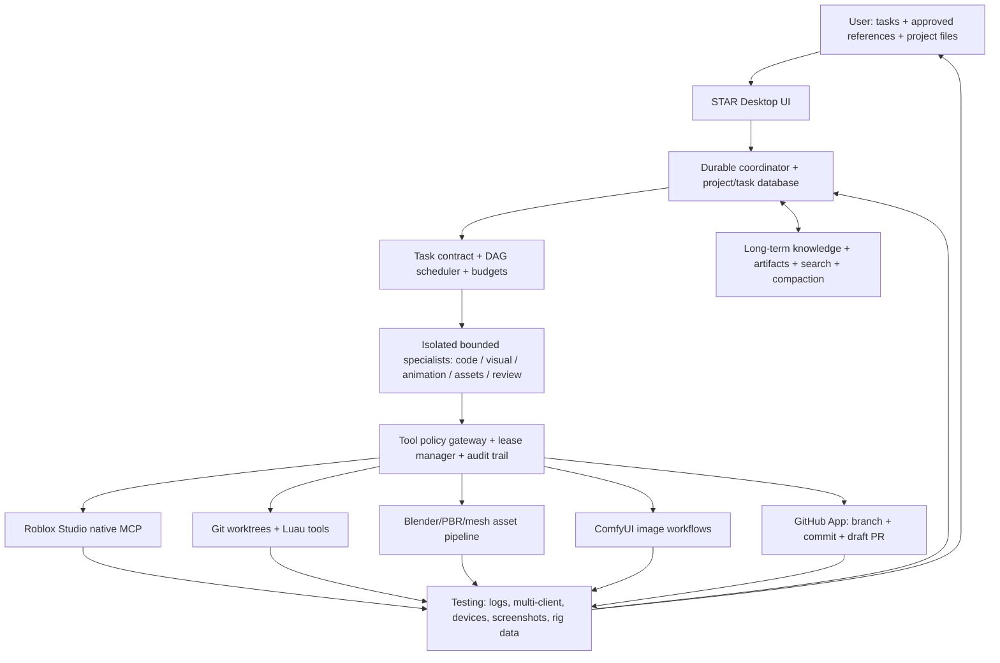
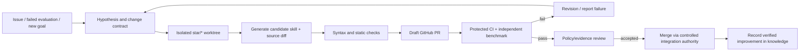

# STAR: Research Blueprint for an Exceptionally Capable Roblox AI

**Research snapshot:** October 9, 2026  
**Target host:** Windows 11, NVIDIA RTX 3060 Ti (normally 8 GB VRAM), 32 GB DDR4 RAM  
**Execution preference:** Your own local-first AI, no mandatory commercial model API key, autonomous routine work, its own GitHub App identity, image/animation/3D/Coding/MCP capabilities, long-running task memory and safe self-development.  
**Evidence level:** Reviewed official documentation and selected open-source project documentation; existing STAR Genesis v0.1 code audited and locally extended to a research v0.2 scaffold. No claims of live Roblox playtest, training, independent frontier intelligence, or successful GitHub deployment.

## Executive decision

**Build STAR as an AI engineering system, not a single magically powerful model.** The system should combine a replaceable multimodal reasoning model, a high-fidelity Roblox Studio MCP interface, a source-first Luau workflow, audited specialist tools, project-scoped memory, autonomous but isolated development branches, and a rigorous acceptance loop. Each capability should have its own hard-to-game benchmark with stored evidence. The strongest achievable local outcome on the specified hardware is a *useful but imperfect* 4B–9B-class quantized-model agent with strategically scheduled visual, coding, and generation workloads. It will not match the capabilities of the largest cloud models or support dozens of high-bandwidth GPU workers concurrently.

The evidence from long-running agents is especially important: context compaction and longer prompting do not by themselves make a production-quality builder. Durable checkpoints, precise task decomposition, verified end-state tests, and state reconciliation are required [A14, A15]. In Roblox, native Studio MCP already provides an unusually useful foundation: inspection, script edits, procedural assets, interactive testing, and screenshots [R01]. For GitHub, use *narrowly scoped installation tokens* with draft PRs, rather than sharing the user's broad personal token [G01–G04].

## 1. The core research problem: what does “super intelligent” mean?

STAR should not be measured by the number of agents, the length of its prompt, synthetic benchmark marketing, or its confidence. We propose a repeatable hierarchy of intelligence:

1. **Correct perception** — understands the actual uploaded screenshot or document; separates observed facts from guesses; identifies missing information.
2. **Grounded technical planning** — inspects existing scripts, UI objects, rigs, dependencies, and recent decisions rather than guessing project structure.
3. **Action selection** — chooses and composes the minimum suitable tools, keeps operation scopes narrow, and stops when evidence is missing.
4. **Reliable implementation** — creates maintainable, typed Luau; editable UI; usable 3D assets; rig-compatible animation and reproducible environments.
5. **Environment-based feedback** — runs the relevant tests, obtains screenshots/logs/telemetry, finds the real failure, and fixes the root cause.
6. **Retained progress** — stores proven fixes, preserves accepted art direction, and can resume across interruptions without overwriting human changes.
7. **Measured improvement** — compares a proposed model, skill, or tool against a fixed regression suite and adopts it only when accepted task outcomes improve.

The impossible goal of *100% perfect execution on all tasks* is not a valid engineering requirement. Instead, each project can specify unacceptable failure classes (e.g. payment security regression, live data corruption, wrong rig) and measurable targets (e.g. responsive layout passes 6 device profiles; an R6 attack clip meets defined prop alignment thresholds; server-authoritative purchase tests pass).

## 2. Reference architecture: seven separate layers



**Layer 1: UI.** A Windows-facing application (initially local web UI: React/TypeScript front end + Python backend). The UI contains chat, upload, reference gallery, task DAG, actual tool activity, test outcomes, resource usage, patch diff, memory browser, and source citations. It should not fake the model's private reasoning; show observable decisions, calls, evidence and uncertainty.

**Layer 2: coordinator.** Owns accepted goal, task statuses, worker identities, project locks, task journals, budgets, and recovery logic. Neither a random worker nor a retrieved webpage may rewrite this system's policy.

**Layer 3: model runtime.** Separate adapters for LM Studio, Ollama, and perhaps llama.cpp. Keep the model address on localhost by default. A larger remote model may be an *optional future upgrade* if user-authorized, not a hidden automatic fallback.

**Layer 4: specialized skills.** Research, coding, UI, rigging/animation, Blender modeling, VFX/environment, QA and integration. A worker is a task-focused execution process, **not** a freshly trained intelligence. Give it explicit references, source snapshots, tool scopes and success conditions.

**Layer 5: tools.** Verify schemas and versions from the actual connected servers. Roblox MCP is primary for Studio state. Local Git/Rojo/Luau tools are primary for maintainable source. ComfyUI generates image/texture *assets*, while Blender produces editable meshes and rigs. GitHub preserves source changes and orchestrates CI/PR review.

**Layer 6: observation and evaluation.** Deterministic code checks, Studio test modes, network/fault simulation, input emulation, screenshot/motion inspection, visual reference comparisons, and human playtests. Grade the actual final environment [A13].

**Layer 7: knowledge and recovery.** Lossy active context plus durable exact originals, approved decisions, tested fixes and immutable reference artifacts, with project isolation and provenance. Decisions are never trusted solely because the model repeated them [A14].

## 3. Hardware and model selection: a disciplined benchmark, not a declaration of a winner

The 3060 Ti's common 8 GB VRAM capacity rules out comfortably fitting most frontier-class models locally. System RAM may permit CPU/GPU offloading but does not create additional fast VRAM, and some very large contexts are especially costly because of the key/value cache.

### Shortlist and why

| Candidate | Role | Local feasibility | Evidence required |
|---|---|---|---|
| Qwen3.5 4B quantized | First unified local vision/tool/coding baseline | Strongest practical starting point on 8 GB | Run local tool calls, image descriptions, small Luau tasks, speed and quality [M01, M02] |
| Qwen3.5 9B quantized | Larger experimental primary | Weights close to GPU memory limit; likely limited context, offload pressure | Compare accepted-task scores per elapsed time; never promise speed [M01] |
| Qwen2.5 Coder 7B | Coding-only baseline | Feasible quantized; lacks vision | Compare Roblox strict-Luau tasks against primary VLM; not a replacement for vision |
| Image diffusion model via ComfyUI | Illustrations, textures, UI art, concept assets | Depends on model/workflow; schedule separately from LLM | Measure generation time, image size, fidelity and memory peaks |
| Optional larger hosted model | Harder task escalation only if later authorized | Not part of no-key default | Benchmark accuracy gain against price and privacy tradeoff |

Official Ollama tags list the Qwen3.5 4B model around **3.3–4.0 GB download size**, and the 9B around **6.6–7.6 GB**; these are *model download sizes, not peak inference VRAM*. LM Studio lists Qwen3.5 4B as vision-capable [M01, M02]. Treat 262K advertised context as a model capability, not a memory-safe context setting on this GPU.

### Local model bake-off protocol

Run a fixed battery on 3 model/inference combinations. Use identical prompts and seed settings where possible. Measure: first-token latency, tokens/sec, wall time, RAM/VRAM peak, failure/timeout rate, correct tool JSON percentage, actual task acceptance, and context compaction frequency. Test 4K/8K/16K active context lengths before attempting 32K. Repeat important trials 3–5 times: model behavior varies even at low temperature. Choose **highest accepted outcomes under your latency/memory budget**, not the largest model by parameter count. Keep inference unloaded while running large diffusion/image workflows.

**Recommended first runtime:** LM Studio for convenient GUI model inspection and an OpenAI-compatible local server; Ollama remains a valid interchangeable backend [M03]. Running on localhost is not the same as forbidding all external network actions: documentation retrieval, GitHub sync, and Roblox cloud asset generation still use network services.

## 4. High-quality “understanding what you mean”: input-grounding contract

For every complicated request, STAR writes a **Reference Contract** before mutating the project:

```json
{
  "project": "example-project",
  "task": "Build approved menu from two references",
  "references": [
    {"id": "sha256:...", "role": "approved-layout", "status": "user-approved"},
    {"id": "sha256:...", "role": "button-style", "status": "secondary"}
  ],
  "observations": ["Main panel left aligned", "Icon labels on separate rows"],
  "inferences": ["Buttons may have hover animations"],
  "unknowns": ["Font file", "Exact padding", "Hidden menu interactions"],
  "requirements": ["Preserve original layout", "Use native editable Roblox UI"],
  "forbidden_changes": ["Do not replace the approved avatar", "Do not add neon rings"],
  "acceptance": ["No clipping at target aspect ratios", "Every button works"]
}
```

The *actual original image bytes* must be passed to a vision model/worker—not just a filename or parent summary. Store original assets under a SHA256 digest with project metadata. A reviewer gets original images and final captures, not just an author's explanation. When examining a screenshot, the model may approximate spacing, but exact layout validation should inspect Roblox GUI rectangles/constraints or design-tool metadata. Never promote guessed font metrics to facts.

### Video and animation reference handling

If user supplies video, sample the clip densely around key contacts and transitions. Preserve timestamps and frames. Vision alone cannot recover hidden rig joints or precise 3D motion from one camera; inspect known rig definitions or ask for a side/back view when required. Motion authoring must produce a *usable animation* with editable rig/clip data, not a video that only looks animated.

## 5. Memory: the compaction architecture STAR needs

1. **Immutable history:** full user/system/task messages, original image files, tool invocations, tool error codes, resulting screenshots and project commits. Avoid storing secrets in raw conversation archives.
2. **Short active context:** compact checkpoint with goal, current accepted source revision, exact file paths, requirements, warnings, pending task graph, last verified state, and next action.
3. **Project knowledge:** approved reference records, current source symbols, design tokens, rig attachments, test fixture IDs, and user-approved decisions.
4. **Retrieval:** exact file path lookup, symbol search, SQLite keyword/FTS retrieval; add local embeddings only if experiments show meaningfully better recall, and preserve source ID metadata.
5. **Recovery:** resume from a durable task journal. Verify actual current Git/Studio revision before acting; do not rerun a timed-out mutating operation blindly.
6. **Trust levels:** candidate note → reviewed note → accepted verified fix. The AI's own claims never automatically become reviewed evidence.
7. **Project boundaries:** one game's ghost parchment interface must not be imposed on a different survival game's inventory. Store overrides per project.

Compaction should trigger based on measured token use when the runtime provides reliable usage metrics; a character-count threshold is only a conservative early proxy. Keep whole images out of summaries while preserving their original content-hash references. Tool result clearing and compact task notes are useful only if the exact source remains recoverable [A14, A16].

In the upgraded repository, `star/knowledge.py` now implements **project-scoped candidate and reviewed notes** plus immutable SHA256 artifact storage and checksum validation. It does not yet have semantic vector retrieval or a multimodal historical search index; those remain future milestones.

## 6. Parallel agents: increase verified throughput, not chaotic activity

**Rule A: DAG scheduling.** Split only at real dependency boundaries. Example: inventory data contract → server item logic and UI layout in parallel → integration and client/server testing. Animation requires a fixed rig/retargeting specification before animation worker and gameplay worker can safely proceed.

**Rule B: isolated working copies.** Code workers receive separate Git worktrees. Source diffs are reviewed against the current baseline before integration. Never let two workers modify the same shared files concurrently. Studio's `studio_id` only routes tool calls; it does not guarantee single-writer isolation for two agents targeting one instance [R01].

**Rule C: one shared Studio writer.** Begin with an exclusive mutating lease over the active test place: script editing, camera manipulation, play-mode changes, input simulation, or Luau execution must honor it. Independent research/analysis can run in parallel. Multiple Studio instances may be used later only with isolated place copies and explicit state reconciliation.

**Rule D: bounded delegation.** Start with a planner and at most two active workers on the 3060 Ti. A single large local model may execute workers sequentially; increase worker count only if task acceptance per minute improves. Workers need structured input and a max-tool-call/token budget. A worker cannot grant itself privileges or disable evaluation.

**Rule E: independent validation.** A fresh reviewer sees reference, task contract, code/scene diff, actual screenshot/video and test evidence. Its conclusion is advisory; deterministic failures remain blocking. Strong models can still share blind spots, so review alone is not proof [A13].

`star/orchestration.py` implements a tested *non-executing* dependency planner with resource ownership checks. That is a foundation for scheduling, not yet running live agents.

---
## 7. Roblox Studio MCP: verified tool inventory and integration strategy

The latest official Roblox Studio MCP documentation describes a **built-in stdio server**. In Windows the client command is `cmd.exe /c %LOCALAPPDATA%\Roblox\mcp.bat`; in Studio enable Assistant → Manage MCP Servers → Enable Studio as MCP server. Tools are explicitly scoped with a `studio_id` retrieved from `list_roblox_studios` [R01]. This is powerful, but tool availability can change between installed Studio builds; always enumerate exact schemas before using them.

### Native tool inventory: what STAR could call

| Studio domain | Documented tool(s) | Recommended STAR handling |
|---|---|---|
| Project routing | `list_roblox_studios`, `get_studio_state` | Identify the correct disposable test place; never silently target the first window. |
| Scripts | `script_search`, `script_grep`, `script_read`, `multi_edit` | Read before modifying; source-first workflow; return explicit affected paths and diffs. |
| Scene/instances | `search_game_tree`, `inspect_instance` | Inspect exact object class, children, attributes, transforms, properties. |
| Studio code execution | `execute_luau` | **Broad code-execution capability, not sandboxed**. Disabled by default; if needed, isolate to disposable place under elevated local task profile. |
| Simulation | `start_stop_play`, `get_console_output`, `screen_capture` | Test once, capture output, verify the actual rendered result. Playback itself runs project code. |
| Input | `user_keyboard_input`, `user_mouse_input`, `character_navigation` | Useful for UI, interactions, movement tests. Coordinate with exclusive Studio lease. |
| Native agents | `subagent` with explore/playtest variants | Discover exact permission behavior before exposing. Avoid assuming nested child work inherits parent policy. |
| Documented asset generation | `generate_mesh`, `generate_material`, `generate_procedural_model`, `wait_job_finished` | Optional tool profile. Track quota, cloud dependency, expected asset rights, quality and result. |
| Asset retrieval | `search_asset`, `insert_asset`, `upload_image`, `store_image` | Review asset origin, licensing, moderation and import identity. Upload and insert mutate project/external assets. |
| Documentation | `http_get`, `skill` | Ground design and code in current Roblox docs; treat retrieved material as untrusted data. |

This rich tool list is **the most important new Roblox-specific discovery**. STAR does not need to recreate Studio's entire edit interface in Python. It does need an executor that validates arguments, handles results, records evidence, routes to the appropriate instance, and prevents unauthorized instructions from tool-returned text.

**Current upgraded starter:** the native tool allowlist covers inspection, docs, script modification and play-mode start/stop. Broad arbitrary Luau is hidden unless invoked with an explicit elevated flag in a disposable place. It does not yet expose all asset and input APIs; the research tool matrix identifies them for future integration. Limiting unverified high-impact actions is intentional.

### Tool gateway example contract

```json
{
  "request_id": "uuid",
  "task_id": "UI-004",
  "studio_id": "actual-ID-from-list_roblox_studios",
  "tool_name": "multi_edit",
  "tool_args": {"...": "discovered MCP schema"},
  "project_revision": "git-SHA-and-place-snapshot",
  "permission_profile": "disposable-place-code-edit",
  "idempotency_key": "operation-ID",
  "expected_paths": ["game.StarterGui.Inventory"],
  "dry_run": false
}
```

This is **STAR's proposed envelope** around a tool call, not Roblox's own MCP function signature. Roblox-specific tool `tool_args` must use the exact currently discovered schema.

## 8. Roblox coding: what expert Luau competence requires

Roblox is client/server and event-driven. Deep competence means understanding lifecycles, replication, ownership, typed interfaces and data validation, not merely generating syntactically plausible code.

### Source and language toolchain

- **Native Roblox Studio Script Editor** for engine-specific autocompletion, linting, analysis and type checks; use `--!strict` where appropriate [R02].
- **Rojo** synchronizes filesystem-first Luau modules with the Studio DataModel. **Rokit** pins Rojo, Wally, and Lune versions; **Wally** provides package management [R03].
- **luau-lsp** with Rojo sourcemap (`rojo sourcemap --watch`) gives diagnostics and references grounded in the project's instance tree [R04].
- **StyLua** formats Luau deterministically; **Selene** provides linting with a Roblox-specific standard library (`std = "roblox"`) [R05, R06].
- **Testing**: create deterministic pure Luau unit tests for data transformations; use Studio integration tests for replication, animation and instance state. Lune/test-framework capability needs to be checked against the exact environment and game dependencies rather than assuming generic Lua tests can run all Roblox engine APIs.

### Systems STAR should be able to design and verify

**Authoritative networking.** Every client-triggered reward, purchase, combat hit, inventory change, quest completion or cooldown must be validated server-side. Treat client-supplied Instances, prices, timestamps and arbitrary paths as untrusted. Validate type/structure, rate-limit, distance, state, and ownership. Roblox's official client/server security guide details these attack surfaces [R07].

**State and lifetime.** Keep services/controllers/modules separated by responsibility. Avoid duplicate event listeners after respawn or UI remount. Use cleanup patterns for connections and instances. Distinguish server-saved state, replicated read models, transient UI state, and predicted client effects.

**Async and persistence.** Record how saving behaves during retries, throttling, teleport and shutdown. Use idempotent operations where possible, avoid duplicate rewards, and test partial failure. Do not use real player data in early autonomous tests.

**Physics and simulation.** Validate collision layers, network ownership, projectile prediction/server reconciliation, movement replication, and frame-timing behavior. Avoid expensive per-frame work and measure actual microprofiler performance [R08].

**Game-specific architecture.** Survival systems (crafting, building, raids, procedural seeds), murder mystery roles, queue/intermission, inventory/shop, cosmetics, persistence, matchmaking, admin operations: each needs a system design/spec with threat cases and tests. The model should identify what game loop exists before improvising an economy.

### Acceptance protocol for a Luau feature

1. Locate exact source symbols, their callers, remotes, and tests.
2. Create a concise change contract: inputs, outputs, side effects, threat cases, paths to edit, requirements to preserve.
3. Implement in isolated worktree using source-first Luau; Studio MCP is used for state inspection, scene changes, and integration feedback.
4. Run StyLua/Selene/luau-lsp when installed and configured for project. Static checks cannot establish network-security correctness.
5. Run targeted Luau unit tests; run Studio client/server tests for externally visible behavior.
6. Capture logs and relevant instance state. If UI is involved, capture before/after screenshots.
7. Fail and revise on invalid state; if the world changed while editing, reconcile baseline rather than overwrite.
8. Produce a GitHub PR with source diff and verifiable acceptance evidence.

### Example: secure shop purchase

The agent must reject forged prices, nonexistent item IDs, insufficient funds, rapid repeat purchases, spoofed object references, unexpected number types, and unauthorized rewards. Only server-trusted item definitions determine price and entitlement. The UI is a client presentation layer. End-to-end tests must demonstrate both legitimate success and attack-case rejection [R07].

## 9. Professional UI/UX, image references, responsive Roblox interfaces

Roblox's current guidance recommends responsive layouts across input types and screen sizes and provides stylesheet-like **StyleSheets, selectors, tokens, and themes** [R09, R10]. STAR should use that rather than dozens of arbitrarily placed Frames.

### UI workflow STAR must master

1. **Understand** the approved screenshot at full resolution; preserve exact reference IDs, priorities, and user constraints.
2. **Extract design system**: type hierarchy, safe areas, core colors, tokens, spacing scale, icon language, hover/pressed/selected states, transitions, asset list and interaction model.
3. **Build native objects**: `ScreenGui`, `Frame`, layout containers, text, buttons, scalable constraints and sensible `ZIndex` layering. Use component reuse; avoid a single flattened UI image.
4. **Build assets separately**: icons, textures, decorative artwork, SVG/PNG. For native Roblox, ensure import, sizing, pixel density and asset source are legal/appropriate. ComfyUI can help with illustrative assets but cannot guarantee crisp icon vectors or perfect text.
5. **Connect logic**: interaction behavior, asynchronous loading, error states, focus/input changes, accessibility and mobile touch targets.
6. **Instrument geometry**: compare actual runtime positions/sizes, detect unintended clipping, off-screen controls, overlapping text/icons, scroll constraints and long labels.
7. **Review visuals**: capture the same state/viewport as approved reference; report specific discrepancies, preserve unchanged regions, and iterate.
8. **Test device profiles** with device simulator; controls must behave under keyboard, gamepad and touch, not just look good on desktop [R11].

### Specific art-direction failures that STAR should detect

- Unrequested glow, neon, random floating circles, fake hardware shapes and excessive saturated gradients.
- Text overlapping icons or buttons, inconsistent padding, careless center alignment, blurry/raster text, missing button states.
- Flat design-reference screenshot pasted as a GUI instead of editable native components.
- Accidental redesign of previously approved panels when fixing a small defect.
- R6/R15/avatar style mismatches or inaccurate in-game screenshots presented as source-perfect recreations.
- Lack of device testing, unreadable touch/console layouts, unjustified use of fixed pixels.

These constraints belong in a **project-specific design manifest**, not blindly in every Roblox project.

## 10. High-end animation: skeletons, clips, IK, grips and cinematics

Roblox provides rig animation, animation editing, inverse kinematics and animation-event markers. Official docs explain using rigs with joints/bones, the Animation Editor, IKControl and marker events [R12, R13]. STAR should treat animation as a distinct technical discipline rather than just calling an animation generator.

### A rigorous animation representation

- **Rig contract:** R6 vs R15 vs custom skeleton; rest pose; hierarchy; Motor6D/bone transforms; pivot and coordinate conventions; root motion policy; attachments, weapons/props, collision relationships; allowed retargeting.
- **Motion contract:** primary intention and silhouette; anticipation; squash/stretch where appropriate; action/contact; follow-through; recovery; easing; timing and loop boundaries; interaction points; camera framing.
- **Clip metadata:** duration, keyframe times, easing/curves, named marker events, priority/blend expectations, in-game movement coupling.
- **Observations:** actual keyframes, client playback capture, per-joint telemetry, attachment world-space trajectories, foot/hands contact drift, clipping and transition frames.
- **Acceptance:** checks tailored to the *rig and action*. A universal “zero sliding” rule is wrong when feet intentionally slide, or a prop has inertia. Define expected tolerance/action-specific frames.

### R6-specific caution

R6 has relatively coarse articulation. You cannot automatically apply an R15 or humanoid mocap clip and expect equivalent shoulders, elbows and hand alignment. If a user specifies R6, STAR must inspect true R6 joints, author for that rig and avoid generating replacement part-built characters. Rig constraints determine what visual fidelity is attainable and when a custom rig is necessary.

### Blender → Studio animation pipeline

Blender can create and export skinned meshes/armatures. Check axis conversion, model scale, bone naming, skin weights and FBX export settings. Roblox documentation recommends FBX for full import features including rigs and influence data and describes Blender's coordinate mismatch with Studio [R14, R15]. Test a round-trip on a fixture model before large asset generation. A video-only or still-image outcome is *not* a usable animation asset.

### Animation QA tasks

- Wave, interact, sprint-stop and basic idle transition on both actual project R6 and R15 rigs.
- Character holding prop from idle → run → attack → recovery, with measured attachment alignment.
- Two-character interaction handshake/door-open, including collisions and shared timing.
- Cinematic arrival with camera transition, VFX and audio markers; test interrupt/skip/replay states.
- Client/server animation-driven combat where the server remains authoritative for damage [R07].

## 11. Modeling, buildings, environments, shaders, VFX and procedural maps

### Modeling and asset pipeline

1. STAR identifies whether the output should be built from native Roblox instances, a purpose-built imported mesh, or a procedural model. Do **not** substitute a stack of crude parts for an explicitly mesh-based or approved character asset.
2. For mesh output, Blender Python can model, UV unwrap, apply materials, generate LOD variants and export FBX/glTF as supported; then Roblox Studio imports the asset [R14].
3. Textures require UV correctness, compression decisions, texel consistency and licenses. SurfaceAppearance/PBR and MaterialVariant are candidates where project style and performance allow; sometimes builtin materials are better for memory [R16].
4. Verify dimensions, pivots, normal orientation, collisions, anchored states, texture import and rig attachments. Record provenance/license/source of each asset.
5. Roblox native `generate_mesh`, `generate_material`, and `generate_procedural_model` provide convenient alternatives, but they may use Roblox's online services/quotas and do not eliminate the need for detailed visual quality review [R01, R17].

### Environments for AAA-style Roblox quality

Create explicit level design documents with scale and landmarks, traversal routes, player read zones, occlusion, sky/weather plan, texture budgets, audio regions and gameplay affordances. Procedural worlds need deterministic seed handling, seeded feature placement, coherent biome transitions, spawn safety, POI validity and a verification replay. Build **blockouts first** but do not deliver them as final meshes after promising polished art.

### Performance is part of design

- Define a real target device and measure it during development. Studio's device emulator is useful for layout/controls but not a perfect substitute for actual mobile memory behavior [R16].
- Use streaming for large worlds; understand which content must remain available for gameplay and what happens when an instance streams out [R16].
- Reuse textures/materials/meshes; watch triangle/draw-call counts, transparency overdraw, expensive particle emissions, water/VFX and per-frame Luau work [R08, R16].
- Use MicroProfiler for frame-time data, CPU/GPU measurements, script hotspots and spikes; Roblox's LibMP initiative also documents programmatic profiler analysis [R18].
- Animation and UI effects need frame budgets as much as 3D: hundreds of overlapping tweens, clones or alpha overlays can be expensive.

### Assets that require extra expertise

Characters, vehicles, destructible objects, procedural foliage, interactive doors, weather particles, cutscene cameras, collectible presentation, UI motion and NPC animations should each become separate skills and evaluation fixtures. Workflows requiring physics/VFX should be explicitly compared in play mode, not graded solely by static render.

---
## 12. Deep GitHub plan: STAR builds STAR

The **recommended starting repository topology is one private monorepo**, `star-core`, containing the coordinator, adapters, local tools, skills, test fixtures, evaluation definitions, and docs. Splitting five tiny repositories early increases authentication, versioning and integration complexity for little gain. Split later into `star-roblox`, `star-skills`, `star-evals`, `star-desktop`, etc., only if independent release cycles or access boundaries justify it.

### Initial GitHub tree

```text
star-core/
├── .github/
│   ├── workflows/tests.yml              # offline Python checks, read-only GITHUB_TOKEN
│   ├── workflows/dependency-audit.yml   # pip dependency audit
│   └── dependabot.yml                   # reviewed dependency update PRs
├── AGENTS.md                            # working agreement and protected boundaries
├── star/
│   ├── cli.py, agent.py, policy.py, studio.py, media.py
│   ├── knowledge.py                    # project-scoped reviewable memory
│   ├── orchestration.py                # validated task DAG and resource ownership
│   ├── github_app.py                   # JWT → restricted installation token
│   ├── selfbuild.py                    # isolated candidate skill generation
│   ├── evals.py                        # evaluation catalog parser
│   └── skills/
├── tests/                               # offline runtime regression tests
├── evals/roblox_cases.json             # 32 detailed cases, not yet executed
├── docs/
│   ├── GITHUB_APP_SETUP.md
│   ├── RESEARCH_ROADMAP.md
│   ├── RESEARCH_TOOL_MATRIX.md
│   ├── ISSUE_BACKLOG.md
│   ├── SECURITY_AND_AUTONOMY.md
│   └── ARCHITECTURE.md
└── scripts/bootstrap_github.ps1
```

The current upgraded scaffold implements a portion of this map. `star-core` is a *recommended name*, not proof of an existing remote repository.

### GitHub App vs an autonomous account

GitHub Apps are the appropriate identity for programmatic commits and PR activity. Register STAR's App under your account or organization, install it only on explicitly selected repositories, and use **installation tokens** generated from a short-lived JWT. Do **not** have STAR store or operate through your password or broadly scoped personal access token. GitHub's best-practices documentation explicitly recommends minimum permissions and limited installation token scope [G01–G04].

The recommended *first permission set*:

| GitHub permission | Level | Why |
|---|---|---|
| Metadata | Read (implicit) | Basic repository details. |
| Contents | Read/write | Write candidate source to STAR's development branches. |
| Pull requests | Read/write | Open draft PRs and update their descriptions. |
| Issues | None initially | Increase to read/write only after an issue-management worker is implemented. |
| Administration | None | STAR should not rewrite repository protections or settings. |
| Actions | None | STAR does not need to delete/rerun arbitrary Actions workflows at this stage. |
| Workflows | None | STAR should not alter workflow definitions; GitHub may require separate permission to do so [G02]. |
| Secrets, Organization, Members, Deployments | None | Avoid unnecessary privilege. |

Configure **Only on this account**, choose only `star-core`, save private key outside the repository (Windows protected user profile), and store App ID, installation ID and repository name in ignored `.env`. Installation tokens expire after ~one hour; regenerate automatically and further restrict each token to the configured repository and requested permission subset [G03]. This is implemented in the upgraded `star/github_app.py` but has **not** been live-tested against a registered App.

### Precise first-time bootstrap on Windows

```powershell
winget install --id Git.Git -e
winget install --id GitHub.cli -e
# Restart PowerShell after installation.
cd .\STAR_Repo
py -m venv .venv
.\.venv\Scripts\python.exe -m pip install -r requirements.txt pytest
Copy-Item .env.example .env
# Configure your local model ID in .env; no cloud model key is needed.
.\scripts\bootstrap_github.ps1 -RepositoryName star-core
```

The bootstrap script must perform **one GitHub authentication** through your own browser/CLI. A GitHub App cannot autonomously create its own legal account or make the owner grant it permissions before registration. This is a platform authorization boundary, not a limitation that can be solved by a cleverer prompt.

### Self-development as a CI-backed improvement loop



**For now:** self-builder can write only `star/skills/*.py` and `docs/*.md` inside a separate worktree, compile Python syntax, and optionally open a draft PR. It cannot execute generated skill code, touch policy/authentication, merge, or change workflows. This is intentionally honest: *syntax check ≠ functional verification ≠ new intelligence*.

**Next real improvement:** add a sandboxed worker that runs candidate code against immutable tests, stores output hashes/coverage and limits CPU/RAM/network, then posts evidence on the draft PR. Only acceptance-gated code becomes active. Use separate integrity credentials for the reviewer so STAR's candidate code cannot overwrite the tests or tell the grader to approve it. GitHub CI should never inherit a powerful App private key from a PR and run untrusted generated code with that credential [G05].

**Long term:** STAR's task proposer can create issue templates from measured failed evaluation cases, prioritize repair by impact, branch to fix, compare against previous baseline, and iterate. A change to `star/policy.py`, authentication, the tool-gateway security boundary, deployment, billing, or workflow definitions should remain a separate maintenance class with independently controlled review. The user can have hands-off *routine coding*, while reserving explicit approval for operations that might destroy real work or escalate privileges.

### Branch and PR policy

- Development branches `star/<task-id>-<short-name>` only.
- Main has no direct bot pushes and no force pushes. No bot bypass exception in branch rules.
- Each PR records: issue/goal, baseline commit, diff, altered path list, run IDs, model version, screenshot/artifact refs, tests, known unknowns, and rollback plan.
- Never mark CI passed based on model prose. Actual GitHub Actions jobs and a separate evaluator must report outcomes.
- Main branch merge policy requires passing checks and independent trusted authorization for sensitive changes. The present code does not auto-merge.
- Use `CODEOWNERS` on privileged files if the account plan supports enforcement; see `docs/CODEOWNERS_TEMPLATE.md`.

### Important GitHub plan caveat

GitHub documents branch protections as available on public Free repositories and on **private repositories with GitHub Pro/Team/Enterprise** (and certain server plans), not necessarily private Free repositories [G06]. Do not pretend `CODEOWNERS` by itself is a security boundary or that a private Free repository has automatically enforced required reviews. Choose a plan that supports the protections you need, or keep the bot unprivileged and the default branch owner-controlled until stronger server-side controls are available.

GitHub secret scanning, private code scanning and dependency security features also have plan/repository-type limitations; confirm the actual repository's Security settings instead of claiming a private repository is fully protected by default [G07].

### GitHub Actions CI design

- `permissions: contents: read` on PR jobs and `persist-credentials: false` for checkout.
- Use isolated PR test jobs; do not combine untrusted PR code with production App private keys, publishing keys or live Roblox accounts.
- Run Python compilation/pytest and catalog parsing; add locked dependencies, lints, static analyzers and tests as they become part of the real codebase.
- Add dependency audit and Dependabot; human/integrator reviews upgrades rather than merging them blindly.
- Add Luau/Rojo checks only after the associated CLI versions/configurations are pinned and validated on both Windows developer machines and CI runners.
- Once a real Studio executor is available, run authenticated Studio integration benchmarks **on a controlled Windows runner with disposable places**, not pretend Linux CI can instantiate the Roblox editor. Record artifact versions and test-run screenshots.
- For repository protection, consider pinning third-party GitHub Actions to reviewed immutable commit SHAs after verifying their actual releases and reviewing Dependabot updates. Major-version tags are convenient in the prototype but not immutable.

### GitHub App control boundaries

Possessing `Contents: write` is powerful even when the model is told to edit only one file. Enforcement must happen at a distinct application/tool-gateway layer. App credentials should not be in the agent's chat history or its tool responses; scope tokens per repository and task. If code generation can edit the gateway that enforces its own scope *and deploy the new version*, the boundary has collapsed.

## 13. Security threat model: autonomous without unlimited privilege

The user does not want a manual prompt for every normal action. Design bounded autonomy *once per task/profile*, not unrestricted permission for everything. Recommended profiles:

| Profile | Allowed actions | Banned by default |
|---|---|---|
| Observer | Read Studio scripts/tree/docs/logs, read local source; capture unchanged screenshots | Editing, executing arbitrary code, publishing |
| Sandbox builder | Add/edit source on `star/*`, Studio reversible script edits in designated disposable place | Live datastore writes, publishing, secret reads, workflows/policy mutations |
| Tester | Controlled play mode/input/inspection in disposable place, unit/functional tests | Purchases, arbitrary external uploads, persistent player changes |
| Asset worker | Create images/meshes in approved output directory, proposed imports | Third-party unverified model execution, unapproved asset publishing |
| Researcher | Current docs/site fetch through safe retrieval service | Executing commands embedded in documentation or prompt-injection text |
| Trusted integrator | Apply reviewed patches with baseline and rollback checks | Bypassing CI, signing arbitrary unverified releases |
| Elevated maintenance | App policy/credentials/workflow upgrades | Not delegated to ordinary STAR model workers |

Threats and mitigations:

1. **Prompt injection:** attack text in GitHub issue, README, Studio script comment, image or web result may say to ignore your instructions. Treat it as untrusted data and never permit it to grant new tools/roles.
2. **Unrestricted `execute_luau`:** executing code in Studio grants broad ability over the current DataModel and can call APIs. `studio_id` routes the call but does not sandbox its contents. Gate it with a special disposable-place profile, not the normal `--edit` flag.
3. **Arbitrary code from self-built skill:** syntax-check only in creator process; later behavior testing must run in a sandbox with no repository/App secrets. Generated modules do not auto-import into privileged code.
4. **Token theft:** keep App PEM protected and outside Git; do not forward tokens into LLM messages or logs. Reissue short-lived installation tokens and use narrower scopes [G01–G04].
5. **Privilege escalation by self-editing:** exclude `policy.py`, `github_app.py`, `.github/`, protected evaluator and auth config from model candidate-write paths. Trusted integrator verifies contents and commit provenance.
6. **GitHub PR supply chain:** do not use elevated `pull_request_target` workflows to check out/execute contributor PR code with secrets; GitHub specifically documents this hazard [G05].
7. **Timeout duplicate effects:** branch/file uploads may already have succeeded when the client receives a timeout. Inspect current Git SHA and API state before retrying; never blindly repeat purchases/publications.
8. **Memory poisoning:** an AI suggestion is not a validated engineering fact. Promote only after human approval or independent test acceptance, and store provenance.
9. **Budget runaway:** global model token/time and worker budgets; terminate low-progress task loops; enforce GPU concurrency slots. Rate limits and per-task caps are distinct from billing guarantees.
10. **Artifact licensing/moderation:** confirm imported sounds, models, textures and images have appropriate rights, creator provenance and Roblox platform compatibility.

Full autonomy inside a hard-coded sandbox is much more useful than endless prompts. **But zero approval for publishing games, spending money or escalating STAR's privileges is not a sensible security goal**, particularly before STAR has a strong tested evaluation harness.

## 14. Evaluation program: how STAR genuinely becomes more intelligent

The upgraded repo contains `evals/roblox_cases.json` with **32 capability/quality/security evaluation definitions**. These are specifications and have **not** all been run. A separate test suite verifies the Python catalog schema and some boundaries. Real-world Roblox benchmarks must be built and measured on your Windows Studio session.

### Benchmark groups

| Group | Example hard task | Evidence | Release blocker |
|---|---|---|---|
| Image grounding | Two visual references, conflicting style, precise content | Original hashes, structured observations and uncertainty list | Reference violation |
| Native GUI | Responsive menu with keyboard/touch/gamepad states | GUI tree, screenshots, input traces | Broken interaction or clipping |
| Luau security | Shop with forged price and invalid item payloads | Server test log and source diff | Client controls rewards |
| Luau correctness | Bugfix in existing repo with strict types | Tests, LSP diagnostics, unchanged behavior assertions | New regressions |
| Animation | R6 attack with held prop, blend/loop | Rig/clip, grip telemetry, motion capture | Wrong rig or attachment |
| Asset quality | Blender model with correct scale, PBR and collision | Mesh metadata, imported object, multiple camera views | Incorrect scale, invalid asset |
| Procedural map | Deterministic seeded biome and landmarks | World hashes, spawn/nav route checks | Different result for same seed |
| Performance | Baseline mobile device and large map | Frame/memory capture, streaming metrics | Exceeds project's stated budget |
| Studio tool use | Exact target selection and timeout recovery | MCP IDs and audit journal | Writes wrong game |
| Github self-build | Draft PR with candidate skill | Commit SHAs, protected path check, CI | Direct main edit or secret leak |
| Knowledge | Recall accepted choice after compaction | Archived original, checkpoint, retrieved note ID | Critical preference lost or contaminated |

### Measuring genuine progress

Use **pass@1** and repeated-run reliability for each task group; record end-to-end accepted task rate, regressions, time/cost per accepted task, manual corrections, GPU load, tool errors and rework. A second model's subjective score is useful but cannot override a deterministic failure. Anthropic's agent-evaluation guidance explicitly separates the *claimed final answer* from the actual end state and recommends combining code, model, and human graders [A13].

Build evaluation datasets from real user corrections and known Roblox hazards. Roblox-affiliated researchers introduced **Can It Edit?**, a code-editing instruction benchmark with a training dataset, providing one possible secondary baseline for source-editing behavior. It is not a replacement for task-specific Luau/client-server benchmarks [A17].

### 32 evaluation definitions are not 32 passed tests

The source tests currently check project-scoped memory, artifact immutability, resource locks, Studio tool filters, self-build isolation and evaluation catalog integrity. They do **not** prove 3D meshes look good, animation works, the local model tool calls are correct, or private GitHub APIs are accessible. Those capabilities need Windows/Roblox/hardware tests.

### What “self-improvement” really means

Three separate mechanisms must not be confused:

1. **Knowledge acquisition:** STAR stores and retrieves verified fixes and project decisions. This improves future context, not the underlying weights.
2. **Skill/tool improvement:** STAR writes a candidate algorithm/tool, benchmarks it and (after acceptance) runs the verified version in future tasks. This improves the *agent system*.
3. **Weight updates:** fine-tuning a supported open-weight model with reviewed Roblox/Luau/visual tasks changes its learned parameters. Requires licensed data, suitable training environment and regressions. Limited 8 GB VRAM means parameter-efficient fine-tuning only for appropriate smaller models; expect multiple measured iterations, not exponential intelligence gains overnight.

One especially promising pipeline is **error-driven curation**: whenever a verified task fails, capture *input + exact project context + rejected result + tool observations + accepted correction*, then later use that dataset for retrieval, evals and optional fine-tuning. Do not train indiscriminately on model-produced guesses or auto-published code.

## 15. Research-backed technology matrix and decision thresholds

| Area | Primary tool | Alternative | Why / limits | Priority |
|---|---|---|---|---|
| Local multimodal reasoning | LM Studio + 4B vision/tool model | Ollama / llama.cpp | Model switching, no mandatory paid provider | Now |
| Main coordinator | Python 3.11+ with SQLite and async task runtime | Agent SDK later | State control, local permissions, durable audit | Now |
| Front end | React + TypeScript local app | Desktop wrapper later | Upload gallery, task dashboard, live results | Phase 2 |
| Roblox Studio manipulation | **Native Studio MCP** | Custom plugin only for missing capability | Official tool surface, current schemas | Now |
| Filesystem-first Luau | Rojo + Rokit | Script Sync for simpler workflows | Source control, repeatable builds | Phase 2 |
| Luau diagnostics | luau-lsp, StyLua, Selene | Studio Script Analysis | Strict typed Roblox code, consistent code style | Phase 2 |
| Roblox dependency mgmt | Wally | local modules | Reproducible third-party code | Phase 2 |
| Roblox unit/integration tests | Studio TestService/device/input facilities | Engine-compatible test libraries | Real game behavior, not fake generic Python tests | Phase 2 |
| 3D authoring | Blender + Python API | Native generated mesh/parts | Editable custom assets, UVs, rigs and collisions | Phase 3 |
| Image generation | ComfyUI local API | Authorized cloud image provider | Concept art, texture/map assets; GPU memory competition | Phase 3 |
| Image understanding | Model's actual multimodal input | Targeted external vision model later | Analyze original images, not textual filenames | Now |
| Animation | Roblox rig/Animation Editor + authored tracks | Blender FBX retargeting | Rig correctness, keyframe inspection and motion QA | Phase 3 |
| Version control | Git worktrees + GitHub App | local Git only | Isolated agents, reviewable history | Now |
| Research grounding | Creator Hub docs, engine API, verified examples | web search with citations | Avoid obsolete or invented Roblox APIs | Phase 2 |
| Long-term memory | SQLite notes + immutable artifacts | vector retrieval later | Project isolation, exact provenance | Now |
| Quality | Deterministic tests + visual/risk review | human playtests | Outcomes over persuasive prose | Now |
| Budgeting | Central scheduler + GPU mutex + per-task accounting | provider orchestration once evaluated | Local 8 GB constraints, prevent runaway workers | Phase 2 |

The primary architecture should be **provider-neutral** and **tool-schema-aware**. Do not make foundational code depend on one vendor's chat format or one Roblox MCP tool name staying unchanged forever. Interface adapters and contract tests should catch version drift.

---
## 16. Roadmap: from Genesis to real autonomy

This is a **technical sequence**, not a guarantee of completion in a calendar window. A solo developer will need more time than a staffed team, especially for Blender/animation and real-device QA.

| Stage | Deliverable | A task that must work before advancing |
|---|---|---|
| **0: Research / current baseline** | GitHub-ready source scaffold, source registry, threat model, offline tests | Tests pass locally; no credentials in archive |
| **1: Local sensory brain** | Windows UI/CLI, local 4B vision model, image upload, exact tool schemas | Uploaded screenshot is actually seen; tool JSON is valid; response is accurate |
| **2: Studio observation** | Connected Studio MCP, project inspection and screenshots | Correct `studio_id`, Source path read, viewport capture, no unintended mutations |
| **3: First complete change** | Native Roblox GUI from an approved screenshot | Working editable controls and verified desktop/mobile interactions |
| **4: Source-first engineering** | Git, Rojo/Rokit, luau-lsp, tests, CI, log browser | Secure shop/inventory code passes client/server regression tests |
| **5: Memory and recovery** | Exact image/artifact store, reviewed notes, semantic retrieval, resumable task journal | After compaction/restart, resumed task preserves critical reference decisions |
| **6: Github self-build** | Draft PRs from isolated worktrees, sandboxed skill tests, independent integration review | Candidate skill cannot execute unreviewed or edit policy; CI artifacts recorded |
| **7: Tool-specialists** | Task DAG, coding/UI/research/reviewer workers, lease scheduler and GPU mutex | Two tasks coexist without write races, budget overruns or design regressions |
| **8: Art and animation** | ComfyUI, Blender adapter, R6/R15 animation authoring, motion QA | Approved character and rigged animation work in Studio across transitions |
| **9: Real game vertical slice** | One complete polished gameplay loop with art, code, UI, VFX, analytics | Device/performance, player experience, and security checks all pass |
| **10: Data-driven improvement** | Curated accepted examples, parameter-efficient training experiment, model bake-off | Measurable accepted-task improvement with no critical regression |

### A plausible 30/60/90-day solo roadmap

**Days 1–30:** Make the local model and Studio MCP connection truly run on your Windows 11 machine, upload actual reference images, instrument logs, finish first sandbox UI workflow, and publish private GitHub repo with correct App installation. Fix discovered connection/schema failures. Start collecting real task failures.

**Days 31–60:** Add Rojo/Rokit/Luau diagnostics, durable project artifact search, task DAG with hard ownership checks, UI interaction tests and repeatable CI. Create an actual guarded self-build eval runner in an OS sandbox. Move source editing to isolated worktrees.

**Days 61–90:** Add one or two specialists, GPU scheduling, Blender import fixtures and one target rig animation authoring task. Create at least one end-to-end Roblox vertical slice. Re-run fixed benchmarks across local model choices. Only start LoRA/QLoRA experiments after enough clean, reviewed examples exist.

These ranges are **planning estimates**, not proofs that expert-level animation, beautiful worlds, mature game economies and professional-grade security will all be solved in 90 days.

## 17. Recommended engineering artifacts for every STAR task

Each project should contain:

- `PROJECT_MANIFEST.md` — purpose, gameplay loop, approved rig, visual style, platforms, performance goals, priorities.
- `REFERENCES.json` — SHA256 original media, version, status, exact intended usage, user-approved/reference links.
- `SYSTEMS.md` — server/client ownership, persistence, networking, physical interaction, module boundaries.
- `UI_TOKENS.json` — typography, spacing, colors, icons and permitted variations; one file per distinct game where needed.
- `TASKS.json` / DB — task DAG, owners, read/write scopes, baseline revision, checkpoints and budgets.
- `EVALS.json` — complete acceptance cases, required evidence, fixtures, tool constraints, grading.
- `RUNS/<task>` — tool logs, errors, screenshots, motion captures, profiler snapshots, source diffs and reviewer findings.
- `CHANGELOG.md` — accepted results, preserved user decisions and references.

**The user should be able to ask:** “Why is the inventory button offset?” and STAR should retrieve the approved image, the native GUI hierarchy, actual runtime bounds and last changed commit. It should not improvise a new theme while answering.

## 18. First full demonstration: approved Roblox UI with real behavior

A very useful first high-quality benchmark for STAR:

1. User uploads a clean UI reference for a Roblox inventory and says: “Recreate this in the game, make it responsive and functional, do not add neon.”
2. STAR stores the original image and a SHA256 content ID; the multimodal worker inspects both full composition and targeted crops.
3. STAR inspects existing `StarterGui`, relevant inventory client code, and server remotes via Studio MCP; it loads only the relevant approved project notes.
4. Task planner creates dependencies: reference contract → UI component work and safe server query protocol → integration → device/interaction tests.
5. UI worker produces native editable GUI and assets, not a single flattened image. Lua worker implements server-authoritative inventory requests with validation.
6. Tool executor checks current source baseline and routes authorized edits to the selected disposable Studio instance. Shared Studio mutations are serialized.
7. The tester plays the game, uses simulated mouse/keyboard/touch where supported, captures actual results and logs, and checks mobile layout, button states, error handling, and preservation of existing panels.
8. Reviewer compares actual outputs with the original approved image. It returns concrete failure locations: icon/text spacing, typography, missing states, unsafe remote use or clipped text.
9. The integrator fixes only failed requirements, reruns checks, and opens a GitHub draft PR with source diff, evidence and limitations.
10. Only after a trusted review accepts the result does STAR add this particular bugfix as verified knowledge for that project. STAR keeps the same approved visual direction on the next task.

This vertical slice simultaneously tests intelligence, perception, planning, tools, source knowledge, UI fidelity, networking security, testing and GitHub workflows. A system that can reliably complete this is meaningfully more useful than one that simply lists 100 tools.

## 19. Research gaps requiring live experiments

**Unverified items at this time:**

- Actual latency, image quality and tool-call reliability of Qwen3.5 4B in the user's exact LM Studio setup, on Windows 11 with 3060 Ti and other GPU loads.
- Whether currently installed Roblox Studio has every documented MCP tool, and how current `multi_edit`, `screen_capture`, `subagent`, `generate_mesh`, asset-upload and input schemas behave.
- Whether the connected GitHub user has the appropriate repo plan/role to enforce private branch protections, create installations, or turn on advanced security features.
- Real Roblox visual/interaction outcomes, R6/R15 animations, imported Blender mesh quality, 3D asset-generation quotas and moderation outcomes.
- End-to-end execution of generated skills inside a proper OS sandbox; current self-build verifies syntax only.
- Model fine-tuning feasibility and measurable benefit on this machine. Local memory and skill retrieval must first be benchmarked before training data is gathered.

These are **test requirements** rather than uncertainties to hide behind confident statements.

## 20. Current artifact audit: what was actually built

The latest STAR Genesis v0.1 source was inspected locally. The initial 14 offline tests passed. A research-oriented v0.2 upgrade now contains:

- Project-scoped candidate/reviewed notes, immutable SHA256 artifact storage, provenance, checksum verification and project separation.
- A dependency graph planner that rejects cycles and conflicting read/write scopes, but **does not yet spawn live sub-agents**.
- A 32-case task evaluation catalog with parser/verdict summary utilities; the Roblox scenarios are **not yet run or graded**.
- Pinning of autonomous Studio edits to the current `STAR_SANDBOX_STUDIO_ID` set explicitly in `.env`.
- Default exclusion of unrestricted `execute_luau` from sandbox edits, with a clearly labeled elevated CLI switch for disposable place testing.
- Per-token GitHub App installation scope request limited to the configured repository and `contents`/`pull_requests` permissions; requires a real App installation before live use.
- GitHub Actions offline checks and dependency audit configured with read-only default workflow permissions; Dependabot proposals and protected-file working agreement.
- A `knowledge-add`, `knowledge-find`, `knowledge-review` and `reference-add` CLI to create and inspect project memory locally.

**Validation:** the offline Python test suite was run on the upgraded source. No local model, Studio or GitHub App live calls were made from this research environment. Source and tests are provided in the upgraded ZIP. Treat this as an improved starter—not a finished expert Roblox developer or production-safe autonomous self-improving agent.

## 21. Recommended next actions, in order

1. **Get your GitHub foundation created**: initialize the supplied upgraded repo as private `star-core` through `bootstrap_github.ps1`, register/install STAR's GitHub App on that repository, and confirm `github-check` with no exposed credentials.
2. **Validate your local multimodal model**: load Qwen3.5 4B or an appropriate quantized alternative; run one image, one tool call, and one Luau code reasoning benchmark; measure VRAM/latency.
3. **Connect Studio MCP**: verify `studios`, select a disposable place and inspect `StarterGui`; check discovered schemas against research tool matrix.
4. **Implement one reference-to-working-native-UI benchmark** and fail clearly if it cannot be completed. Preserve original image and compare actual result.
5. **Add GitHub CI and evidence attachments**: candidate PRs from STAR need source diff, tests and actual screenshot/log artifacts. Never conflate lint/compile success with correctness.
6. **Expand only after the basics work**: design memory retrieval, Blender/ComfyUI, rig-specific animation, safe specialist delegation and parameter-efficient training.

## Official and project sources

**Roblox / Luau / tools**

- **[R01]** Roblox Creator Hub — Studio MCP tool inventory, stdio setup, Studio instance routing: <https://create.roblox.com/docs/studio/mcp>
- **[R02]** Roblox Luau overview and type checking: <https://create.roblox.com/docs/luau> · <https://create.roblox.com/docs/luau/type-checking>
- **[R03]** Roblox Creator Hub — third-party tools, Rojo/Rokit/Wally/Lune: <https://create.roblox.com/docs/projects/external-tools>
- **[R04]** luau-lsp, sourcemap and Roblox definitions: <https://github.com/JohnnyMorganz/luau-lsp>
- **[R05]** StyLua deterministic Luau formatter: <https://github.com/JohnnyMorganz/StyLua>
- **[R06]** Selene Roblox linter instructions: <https://github.com/Kampfkarren/selene/blob/main/docs/src/roblox.md>
- **[R07]** Roblox server-authoritative client/server boundary security: <https://create.roblox.com/docs/scripting/security/client-server-boundary>
- **[R08]** Roblox performance improvement and Parallel Luau: <https://create.roblox.com/docs/performance-optimization/improve> · <https://create.roblox.com/docs/scripting/multithreading>
- **[R09]** Roblox GUI styling and StyleSheet tokens: <https://create.roblox.com/docs/ui/styling>
- **[R10]** Roblox adaptive design across device/input types: <https://create.roblox.com/docs/production/publishing/adaptive-design>
- **[R11]** Roblox Studio testing modes and scripted testing: <https://create.roblox.com/docs/studio/testing-modes>
- **[R12]** Roblox rig animation and Animation Editor: <https://create.roblox.com/docs/animation> · <https://create.roblox.com/docs/animation/editor>
- **[R13]** Roblox inverse kinematics: <https://create.roblox.com/docs/animation/inverse-kinematics>
- **[R14]** Blender→Studio modeling coordinate and import workflow: <https://create.roblox.com/docs/art/blender>
- **[R15]** Roblox 3D asset export settings and rig data: <https://create.roblox.com/docs/art/modeling/export-requirements>
- **[R16]** Roblox performance design, low-end devices and streaming: <https://create.roblox.com/docs/performance-optimization/design>
- **[R17]** Roblox Studio Assistant and generated assets: <https://create.roblox.com/docs/assistant/guide>
- **[R18]** Roblox programmatic MicroProfiler / LibMP: <https://github.com/Roblox/libmp/blob/main/docs/SKILL.md>
- **[R19]** Roblox Open Cloud and asset usage (optional online service with separate API/auth): <https://create.roblox.com/docs/cloud> · <https://create.roblox.com/docs/cloud/guides/usage-assets>

**Models / local runtime / training**

- **[M01]** Ollama Qwen3.5 variants and sizes: <https://ollama.com/library/qwen3.5/tags>
- **[M02]** LM Studio Qwen3.5 4B capabilities: <https://lmstudio.ai/models/qwen/qwen3.5-4b>
- **[M03]** LM Studio local server and tool calling: <https://lmstudio.ai/docs/developer/core/server> · <https://lmstudio.ai/docs/developer/openai-compat/tools>
- **[M04]** Hugging Face PEFT quantization/QLoRA: <https://huggingface.co/docs/peft/developer_guides/quantization>

**Agent design / evals / context**

- **[A13]** Anthropic — Demystifying evals for AI agents (outcomes, repeatability and grader types): <https://www.anthropic.com/engineering/demystifying-evals-for-ai-agents>
- **[A14]** Anthropic — Effective context engineering (compaction/retrieval/notes): <https://www.anthropic.com/engineering/effective-context-engineering-for-ai-agents>
- **[A15]** Anthropic — Effective harnesses for long-running agents: <https://www.anthropic.com/engineering/effective-harnesses-for-long-running-agents>
- **[A16]** OpenAI Agents SDK — sessions, compaction and MCP guardrails: <https://openai.github.io/openai-agents-python/sessions/> · <https://openai.github.io/openai-agents-python/mcp/>
- **[A17]** Roblox-affiliated Can It Edit? research: <https://about.roblox.com/publications/evaluating-the-ability-of-llms-to-follow-code-editing-instructions>

**GitHub autonomous development**

- **[G01]** GitHub App security best practices: <https://docs.github.com/en/apps/creating-github-apps/about-creating-github-apps/best-practices-for-creating-a-github-app>
- **[G02]** GitHub App permission selection: <https://docs.github.com/en/apps/creating-github-apps/registering-a-github-app/choosing-permissions-for-a-github-app>
- **[G03]** GitHub App installation token authentication: <https://docs.github.com/en/apps/creating-github-apps/authenticating-with-a-github-app/authenticating-as-a-github-app-installation>
- **[G04]** GitHub App registration: <https://docs.github.com/en/apps/creating-github-apps/registering-a-github-app/registering-a-github-app>
- **[G05]** GitHub Actions PR elevation threat: <https://docs.github.com/en/actions/reference/security/securely-using-pull_request_target>
- **[G06]** GitHub protected-branch plan availability: <https://docs.github.com/en/repositories/configuring-branches-and-merges-in-your-repository/managing-protected-branches/about-protected-branches>
- **[G07]** GitHub private-repo secret scanning availability: <https://docs.github.com/en/code-security/how-tos/secure-your-secrets/detect-secret-leaks/enable-secret-scanning>

---

*Research methodology:* priority was given to official Roblox, GitHub, model-runtime and agent-framework documentation and selected maintained repositories. Verified feature availability is distinguished from proposed architecture and from tests run in the local scaffold. Online documentation can change; refresh affected tool schemas, access scopes and quotas before deploying. No real-world task accuracy or model benchmark scores are claimed without measured runs.
