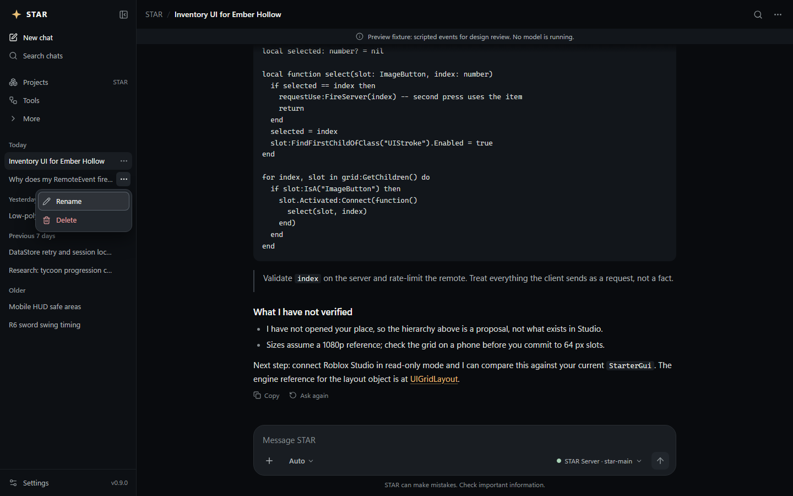
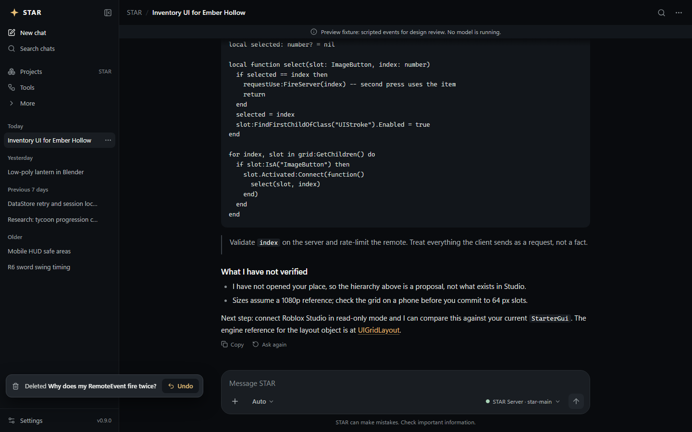
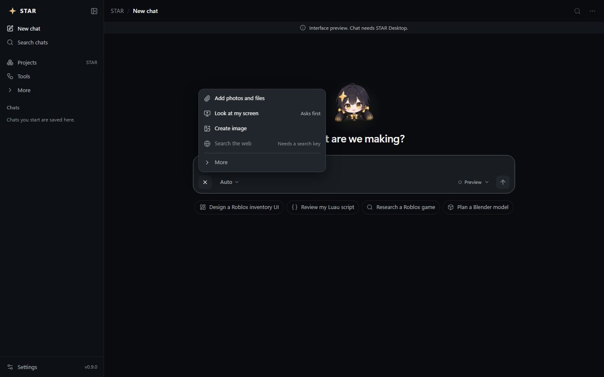
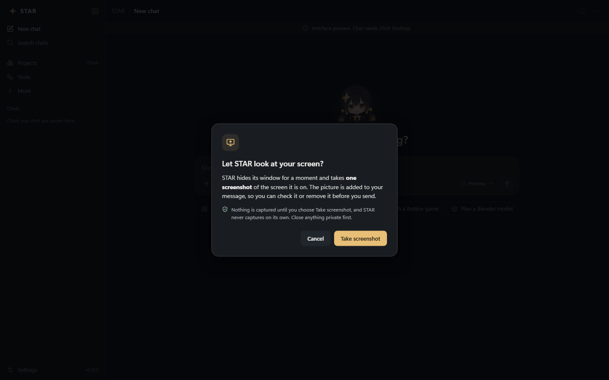

# Chatting with STAR

Everything you do with STAR starts in a chat. This page explains the chat list, the message box and the
**+** menu.

## The chat list

**Status: Available**

Your chats are listed in the left sidebar, newest first, grouped under **Today**, **Yesterday**,
**Previous 7 days** and **Older**. Chats belong to the project you have open (see **Projects**), and the
list shows the 60 most recent.

- **New chat**: click **New chat** at the top of the sidebar (or press **Ctrl+K** to jump to the message
  box). A new chat is called "New chat" until you send your first message; then STAR names it after that
  message.
- **Find a chat**: click **Search chats** and type. This searches chat **names** only, not the words inside
  them. To find words inside the chat you have open, click the magnifying glass at the top right
  (**Find in this chat**).
- **Hide the sidebar**: click the panel button next to the STAR logo. Click **Show sidebar** to bring it back.
- There is no way to pin a chat yet.

### Rename a chat

Any of these works:

- Point at the chat in the sidebar, click the **…** button that appears, and choose **Rename**.
- Double-click the chat's name in the sidebar or at the top of the window.
- Click **…** (**Chat options**) at the top right and choose **Rename**.

Type the new name (up to 80 characters), then press **Enter** to save or **Esc** to cancel.

### Delete a chat, and undo

1. Open the chat's **…** menu (in the sidebar or at the top right) and choose **Delete**.
2. The chat disappears and a message appears at the bottom left: **Deleted** *name* with an **Undo** button.
3. Click **Undo** within about **6 seconds** to get the chat back. After that it is removed for good.

A deleted chat takes its messages and thumbs ratings with it. Pictures it created stay in your STAR files,
and anything STAR learned from it stays in [What STAR has learned](self-learning.md). You cannot delete the
chat that is answering right now: stop the answer first.

### Copy a chat

Click **…** (**Chat options**) at the top right and choose **Copy conversation**. The whole chat is copied as
text you can paste into a document or an email.

## Sending messages

**Status: Available**

- Type in **Message STAR** and press **Enter** to send. **Shift+Enter** starts a new line.
- While STAR answers, the send button becomes a square **Stop** button. A stopped answer offers **Retry** and
  **Edit message**.
- Under each answer: **Copy**, **Ask again**, and thumbs **Helpful** / **Not helpful**. Under your own
  messages: **Edit**. Clicking **Not helpful** lets you [correct STAR](self-learning.md#correct-an-answer).
- While STAR works you see what it is doing, for example "Thinking", "Searching the web" or "Writing the
  answer". Longer jobs show a list of steps under **What STAR did**.

### Fast, Auto or Agent

Click the mode name next to the **+** button (it says **Auto** at first) to choose how STAR works:

| Mode | What it does |
|---|---|
| **Fast** | Quick answer. Can read and calculate attached files. |
| **Auto** | STAR picks the route from your request. This is the starting mode. |
| **Agent** | Plans, uses the tools you have allowed, then checks its work. Slower. |

STAR goes back to **Auto** each time it starts.

## The + menu

Click **+** (**Add files and tools**) at the left of the message box.

*Screenshot from an earlier design build; the web search hint now reads "Needs STAR Server or a search key".*

### Add photos and files

**Status: Available**

Pick up to 8 files per message. STAR can read:

| Kind | Types | Notes |
|---|---|---|
| Pictures | PNG, JPG, WebP | Up to 8 MB each. Ask about them, or use them with **Create image**. |
| Documents | TXT, MD, PDF, DOCX, PPTX, CSV, TSV, XLSX, JSON | Up to 32 MB each. |
| Roblox files | RBXMX, RBXLX | Up to 16 MB. Binary `.rbxm`/`.rbxl` files are refused: in Studio, save as XML (`.rbxmx`/`.rbxlx`) instead. |
| Video | MP4, MOV, MKV, WebM, AVI | Needs FFmpeg installed (see Settings, **Where STAR generates**). STAR looks at a few frames and the first 10 minutes of sound. |
| Audio | WAV, MP3, M4A, FLAC, OGG, AAC | See **Transcribe audio** below. |

Each attached file shows above the message box; click its **×** to remove it before sending.

### Look at my screen

**Status: Available**

STAR can take **one** screenshot so you can ask about what is on your screen. It always asks first:

1. Choose **+ → Look at my screen**.
2. Close anything private, then click **Take screenshot** (or **Cancel**).
3. STAR hides its window for a moment, takes the picture, and adds it to your message. If the box was empty
   it fills in "What do you see on my screen?".
4. Check the picture. Remove it if you change your mind, or press **Enter** to send.

STAR never captures your screen on its own and there is no "don't ask again". The screenshot is saved in
your STAR files (only the newest 40 are kept) and is sent only with your message, to the brain you chose.

### Create image

**Status: Opt-in** (needs ComfyUI and an image model installed on this PC, plus a graphics card)

1. Choose **+ → Create image**. An **Image** chip appears and the box says "Describe the image you want to
   create".
2. Pick a size: **Square 1024**, **Wide 1280 x 720**, **Tall 720 x 1280** or **Draft 512 (fastest)**.
3. Describe the picture and send.
4. To change an existing picture, click **Attach a picture to edit it**. You can also **Add a mask**
   (white = the part to change).

Pictures are made **on your PC** by a separate program called ComfyUI. STAR starts it for you if it knows
where it is installed (Settings → **Where STAR generates** → **ComfyUI folder**). If ComfyUI is not set up,
STAR says "No image engine is set up" and nothing is sent anywhere else. A STAR Server cannot make images.

Finished pictures are saved in your STAR files (marked "Saved locally"). Plain requests like "draw a cat"
also go to the image engine automatically; turn that off with **Create images straight from chat** in
Settings. Click the **Image** chip's **×** to leave image mode.

### Search the web

**Status: Opt-in** (needs a STAR Server with search installed, or your own Brave Search or Tavily key)

1. Choose **+ → Search the web**. A **Web** chip appears.
2. Send your question. STAR searches with the first 600 characters of your message, reads up to 5 results
   and lists its sources.

The switch stays on until you click the **Web** chip's **×** or restart STAR. It is greyed out with
"Needs STAR Server or a search key" when no search is set up.

Where the search goes, in this order: your Brave Search key, your Tavily key, then the self-hosted search on
your [STAR Server](star-server.md). Brave and Tavily keys cannot be typed into STAR yet; they are read from the
Windows environment variables `BRAVE_SEARCH_API_KEY` or `TAVILY_API_KEY` (ask someone technical to set one
up, or use a STAR Server). See [Privacy and data](privacy-and-data.md) for what is sent, including the
automatic search for news-type questions.

### More: Transcribe audio, Use a team, Read STAR source

Click **More** at the bottom of the **+** menu.

- **Transcribe audio** (**Opt-in**): pick an audio file and STAR types out what is said into the message
  box. Runs on your PC. Needs the optional voice add-on; if it is missing STAR says so.
- **Use a team** (**Available**, text only): STAR works through four read-only stages (Evidence, Plan,
  Critique, Synthesis) for a more careful answer. Not available with pictures, attached files or a cloud
  provider.
- **Read STAR source** (**Available**, Agent mode only): lets STAR read its own public source code on
  GitHub (over the internet, no account needed) to answer questions about how STAR works. Read only: STAR
  can suggest changes but never edits the code.

## Keyboard shortcuts

| Keys | What happens |
|---|---|
| Enter | Send |
| Shift+Enter | New line |
| Ctrl+K | Go to the chat and the message box |
| Ctrl+, | Open Settings |
| Esc | Close a notice, a search box or a menu; cancel renaming |
