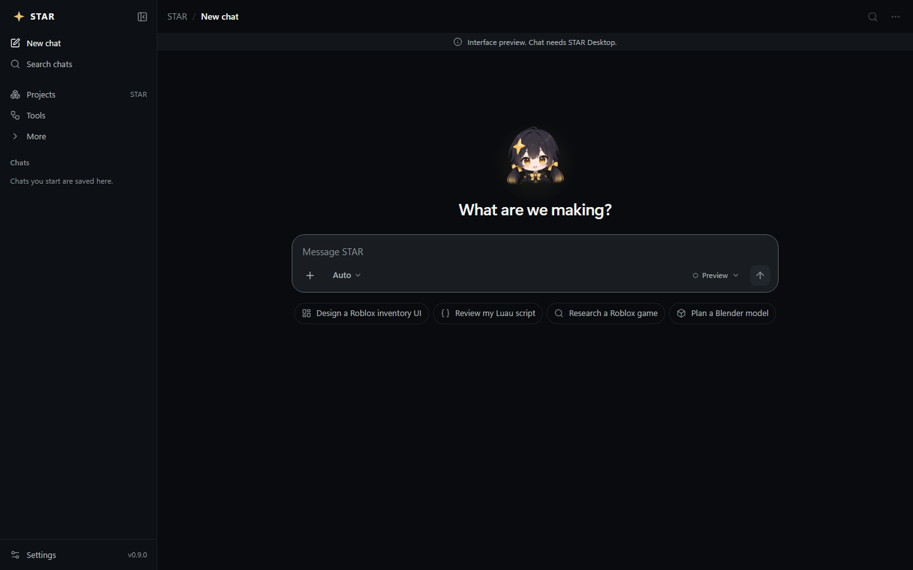

# Getting started

This page takes you from download to your first answer. You do not need to know how to program.

> **Which version does this guide describe?** It was checked against STAR's current development code
> (October 2026). The newest published installer is **v0.9.0**. A few things here may look slightly
> different in v0.9.0, and features marked **Coming soon** are not in any installer yet.

## What you need

| | Requirement |
|---|---|
| Computer | Windows 11, 64-bit. Windows 10 has not been tested. |
| Graphics card | For the brain on your own PC: a graphics card with about 8 GB of video memory and current drivers (tested on an NVIDIA RTX 3060 Ti 8 GB). Not needed if you use a [STAR Server](star-server.md). |
| Disk space | At least 4.3 GB free for the brain on your PC (STAR checks this before downloading). Leave more room for chats, pictures and backups. |
| Internet | Only to download STAR and the brain, and when you choose to check for updates. Local chat then works offline. |
| Account | None. No sign-in and no paid AI key are needed for the brain on your PC. |

## Install STAR

**Status: Available**

1. Open the [STAR releases page](https://github.com/oncoursemail/Star-AI/releases/latest) and download
   `STAR-Setup-vX.Y.Z.exe` (the numbers are the version). A portable ZIP is also offered; the Setup file
   is the easier choice.
2. Run the Setup file. Windows may warn that the publisher is unknown, because STAR is not code-signed yet.
3. Keep the default choice, **just for me**. It needs no administrator rights and installs to
   `%LOCALAPPDATA%\Programs\STAR`. (Choosing **all users** works too, but then Windows asks for
   administrator approval on every upgrade.)
4. Tick **Create a desktop shortcut** if you want one. A Start menu entry is always created.
5. At the end, leave **Launch STAR Intelligence** ticked and click **Finish**.

STAR keeps your chats, settings and downloaded brain in a separate folder, `%APPDATA%\STAR`. Installing
a newer version, or uninstalling, does not touch that folder. See [Privacy and data](privacy-and-data.md).

## Find your way around

The left sidebar has **New chat**, **Search chats**, **Projects**, **Tools** and **More**, then your
list of chats, and **Settings** at the bottom next to the version number. **More** opens **Library**,
**Analytics**, **Brain** and **Model & connection**.

*The chat window. Screenshots in this guide come from STAR's design review and use example data.*

## Give STAR a brain

STAR needs an AI model (its "brain") to answer. Pick **one** of these:

### Option A: the brain on this PC

**Status: Available**

1. Click **More**, then **Model & connection**.
2. In the **Model on this PC** card, click **Download and start**.
3. Wait. STAR downloads the AI engine and a model of about 3.5 GB, checks every file, and starts it. You
   will see steps such as "Downloading STAR engine" and "Verifying and starting STAR Brain".
4. If the download stops, click the button again: finished parts are kept and the download resumes.

Next time, the button says **Start local model**. STAR does **not** start the brain by itself when it
opens, so click **Start local model** when you want to chat. Closing the STAR window stops it again.
You do not need any other AI program (such as Ollama or LM Studio).

### Option B: a STAR Server on your home network

**Status: Opt-in**

If you (or someone in your household) runs a STAR Server, your PC does not need to download a model at
all. Follow [Set up a STAR Server brain](star-server.md).

> STAR uses only the brain you choose. If that brain is off, STAR tells you; it never quietly switches
> to a different brain or to a cloud service.

## Your first chat

**Status: Available**

1. Click **New chat** at the top of the sidebar.
2. Type in the box that says **Message STAR**, for example: *"Explain what a RemoteEvent is in Roblox, in
   simple words."*
3. Press **Enter** to send. To start a new line without sending, press **Shift+Enter**.
4. The answer appears as it is written. To stop it early, click the stop button where the send arrow was.

Not sure what to ask? Under the box on a new chat are starter ideas such as **Design a Roblox inventory
UI**, **Review my Luau script**, **Research a Roblox game** and **Plan a Blender model**. Click one to
fill in the box, then add your details.

Next: learn the rest of the chat window in [Chatting with STAR](chatting.md).

## Keep STAR up to date

**Status: Available**

STAR never checks for updates on its own. When you want to check:

1. Open **Settings** and find the **Stay up to date** panel.
2. Click **Check for updates**.
3. If a newer version exists, click **Install & restart**. STAR downloads the official Setup from the
   public releases page, checks its size and fingerprint, and installs it. Your data is kept.

If STAR cannot reach the releases page, it shows **Open public releases** so you can download Setup in
your browser instead. No GitHub account is needed.
