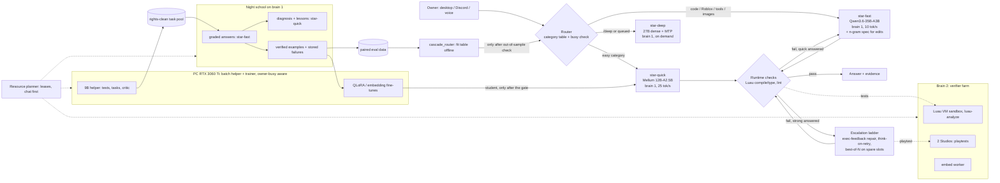

# STAR multi-brain v2: using several local models at once (research, 2026-10-14)

Author: Claude (board item #129, branch `star/multi-model-20261014`). Scope: multi-model systems and learning loops
on STAR's own hardware. Not in scope: picking the single main model (model scout's job) and NUMA/kernel work
(RAMForge's job; ideas that belong there are only listed and handed over).

What was **run** for this document: web research (sources at the end), reading the code on `origin/star/next`
(`0e56896b`), a graphify query, and the new offline simulator `star/cascade_router.py` on the local result files in
`work/eval-runs` and `work/gpu-practice`. Nothing ran on brain 1 or brain 2, no model was loaded or downloaded.
Every speed or quality number below is either quoted from STAR's own measurements (file named) or from a cited
paper; estimates are labelled as estimates.

## 0. The short version

1. STAR already has the parts of a multi-model system: a 10 tok/s strong model (`star-fast`), a 25 tok/s quick
   model (`star-voice`/`star-quick`), a slow dense model with MTP (`star-deep`), a fine-tuned embedder, a reranker,
   a Luau compile/type checker, a Luau VM sandbox, two Studios on brain 2, and a GPU on the PC. What is missing is
   **the policy that decides which model does which step, learned from STAR's own pass/fail data**, and the data
   to learn it from: every result file on disk today was answered by `star-fast` only.
2. On this CPU, the classic speed tricks behave differently than on a GPU. Draft-model and MTP speculation on the
   MoE main model were **measured slower** (server-inference.md 2.3): each token in a verify batch routes to other
   experts, so verifying is not cheap. What can still pay: **draft-free n-gram speculation** with long matched
   spans (code edits), and **sending easy work to the quick model**, which is 2.4x faster per token and 1.5x faster
   at reading the prompt.
3. Quality is protected by measuring, not by hoping. The existing paired gate (`star/eval_stats.py`) resolves only
   about 11 tasks out of 34 on the v2 suite; the same model run twice (v0.9.0 vs v1.0.0 files) disagreed on 9 of 34
   tasks. So every idea below ships default-off, is decided by a paired run, and nothing is fitted on the holdout.
4. Learning-rate levers that work in the literature need a verifier, and STAR has a good one for code: executable
   checks. Rejection-sampling fine-tunes (STaR, RFT, ReST-EM) and DPO from pass/fail pairs both use exactly that
   signal. STAR's blocker is not compute (QLoRA of a 2B model fits the 3060 Ti in 3.5 GB) but **rights-clean task
   prompts**: the practice prompts were written by Claude/Codex agents and are excluded from training.
5. Built in this PR (offline, opt-in, tested): `python -m star.cascade_router`, which simulates quick-first cascades
   and fits a per-category routing table from paired result files, gated by the paired sign test; and
   `python -m star.evals run --pin-model`, without which a "star-quick" eval run silently answers every Roblox task
   with star-fast (the code role is filled by the server's star-fast), so a quick arm could never be measured.

## 1. Facts that drive every decision (all measured on this hardware, sources in the repo)

| Machine | What runs well | Number (source) |
|---|---|---|
| Brain 1, EPYC 7451, 4 NUMA nodes x 1 DDR4 channel, 125 GB | star-fast Qwen3.6-35B-A3B Q4_K_M | 10.4 tok/s gen, 60-71 tok/s prompt, 2 parallel 7.35 tok/s each (brain-performance-20261013.md) |
| | star-voice Mellum2.1-12B-A2.5B | 24-26 tok/s, prompt 107-109 tok/s, first token 0.6-0.8 s (server-inference.md 4.2) |
| | star-deep Qwen3.8-27B + MTP | 2.3 tok/s plain, 4.1-5.5 with MTP; prompt 10-13 tok/s |
| | embed / rerank | 556-570 tok/s with 8 threads; 8 docs reranked in 4.7 s |
| | the limit | memory bandwidth: ~2.57 GB read per star-fast token, 78% of it dense weights, 22% experts (ramforge-20261013.md) |
| Brain 2, i7-9700, 15 GB, Studio + Blender | verifier work, not generation | Luau sandbox run 0.47 s (brain 1: 0.73 s); embed worker 700-750 tok/s; 2 Studios = 439 tested results/h (resource-planner-20261013.md); ~5 GB free beside Studio |
| PC, RTX 3060 Ti 8 GB | batch generation and training, when the owner is not using it | Qwen3.5-9B Q4 fully on GPU with 6 parallel slots for query generation; QLoRA Qwen3.5-2B 3.5 GB VRAM, 6.6 s per 8x1024-token step; embedding fine-tune 5.25 GB, 331 s (gpu-training-pilot.md) |

Two numbers from STAR's own result files, computed for this document (197 scored star-fast answers in
`work/eval-runs/v100-*.json` and `work/gpu-practice/**/*.json`, grouped by the app's own runtime
`luau_check_finished` event):

| Runtime Luau check said | answers | passed the golden checks |
|---|---|---|
| `passed` | 76 | 58 (76%) |
| `failed` | 44 | 18 (41%) |
| `repaired` (one repair round) | 27 | 11 (41%) |

So the runtime static check is a real but imperfect confidence signal: it lifts the pass rate from ~41% to ~76%,
yet 1 in 4 "passed" answers is still wrong. A cascade that trusts it blindly would ship some wrong answers; that is
why the cascade below is decided by the golden checks, per category, and not by the static check alone.

And run-to-run noise: `star.cascade_router --strong v100-v2.json --quick v090-v2.json --allow-mixed` (both arms are
star-fast, two releases one day apart) shows 6 lost and 3 won pairs out of 34, and a table "fitted" on that pair
claims +1 task. That gain is pure noise. Any routing table must be checked on fresh runs (`--table`).

## 2. Ideas ranked by (expected gain) / (effort) on this hardware

Gain is for the dimension named (S = speed, Q = quality, L = learning rate). "Gate" means the paired eval:
`python -m star.evals gate --paired-session` (same model) or `python -m star.cascade_router` (two models), on
golden v2 (34 automated) + creation v1 (23), never fitted on holdout-v1.

| # | Idea | Gain | Effort | Owner of the next step |
|---|---|---|---|---|
| 1 | Quick-first cascade + per-category routing table learned from eval data | S, large on easy categories | S (tool done) + 1 night run | this item |
| 2 | Draft-free n-gram speculation for code edits on star-fast | S 1.5-2x on edits (est.) | config only | RAMForge S6 |
| 3 | Night school role split: quick model for diagnosis/lesson drafts, strong for graded answers | L ~1.5-2x attempts/h (est.) | small | night school |
| 4 | Escalation ladder without new models: think-on-retry + execution-feedback repair | Q on failed answers | small | doc_grounding owner |
| 5 | Brain 2 as the verifier farm (sandbox, luau-analyze, embed worker, Studios) | S/L: frees brain 1 | done in #266, deploy only | resource planner |
| 6 | Bigger measuring stick: rights-clean generated tasks with reference + tests | L: decisions become resolvable | medium | eval owner |
| 7 | PC GPU as batch helper (9B model): test writer, task/variant generator, critic | L | medium | resource planner |
| 8 | Verifier-gated best-of-N, only after a failed check (#270) | Q | medium (exists as draft) | best-of-n |
| 9 | Prefix discipline + KV slot save/restore for long-lived contexts | S first token 20 s -> ~1 s on resumes | small | chat-speed |
| 10 | Store failing answers (scrubbed) so pass/fail pairs exist | L (enables 12) | tiny | night school |
| 11 | Rejection-sampling fine-tune (STaR/RFT/ReST-EM) of a small Luau student on the 3060 Ti | L, S later | large | training |
| 12 | DPO on pass/fail pairs for the student | Q of student | medium after 10-11 | training |
| 13 | Learned kNN router over star-embed-ft1 vectors of past tasks | S beyond the category table | medium, data-bound | this item, later |
| 14 | EAGLE-3 / better MTP only for the dense star-deep tier | S of deep tier | medium | RAMForge |
| 15 | Model-per-node-group placement (star-fast on 3 nodes, quick/embed on node 3) | S under mixed load | measure only | RAMForge S3-S4 |
| - | Rejected: mixed-model MoA, multi-agent debate, GPU draft model over the network, per-node star-fast instances | | | |

### 1. Quick-first cascade + routing table learned from STAR's own eval data (S)

- **How it works.** For a request the router believes is easy (by category), the quick model answers first. The app
  already runs a Luau compile/type check on every answer (`doc_grounding.finalize`). Cascade: keep the quick answer
  if that check passed, else ask star-fast. Routing table: per task category, choose `strong`, `quick` or
  `cascade`, whichever is fastest **without losing a single golden pair** on the measured runs. This is FrugalGPT's
  cascade and Hybrid LLM's router, but with STAR's executable checks as the scorer instead of a trained DistilBERT.
- **Which machine.** Both models on brain 1 (already loaded). Sequential, not parallel, so no bandwidth sharing.
- **Expected gain (evidence).** Quick model: 2.4x generation, 1.5x prompt reading (server-inference.md 4.2), and it
  matched star-fast on 7 of 10 spot checks (failed strict typing, used SetAsync for UpdateAsync). Literature:
  RouteLLM >2x cost reduction at equal quality; Hybrid LLM up to 40% fewer large-model calls with no quality drop;
  AutoMix >50% cost cut at comparable quality. Estimate for STAR: with star-fast at a median 183 s per v2 task and
  the quick model at ~90 s (est.), a cascade costs 90 + (1 - a) x 183 s where a = acceptance rate: a = 0.6 gives
  -11%, a = 0.8 gives -31%, break-even at a = 0.5. Whole categories routed to `quick` save ~50% on those tasks.
- **Risk.** The static check is only 76% precise for star-fast (table above), probably lower for the quick model,
  so `cascade` can lose pairs; escalations pay twice; the category table overfits small categories (shown above).
  Mitigation in the tool: SAFE requires zero lost pairs, `--min-tasks`, out-of-sample check with `--table`, refusal
  to fit on holdout.
- **Measure.** One pinned quick-model run per suite (`python -m star.evals run --pin-model --model star-quick`),
  paired with a star-fast run from the same session, then `python -m star.cascade_router --strong ... --quick ...
  --suite ... --write-table t.json`; a second night repeats both arms and checks `--table t.json` out-of-sample.
  Enable only categories that stay at 0 losses out-of-sample.
- **Smallest first step.** Done in this PR (offline simulator + `--pin-model`). Next: one night of runs (about
  1.5 h for the quick arm on v2 + creation at ~90 s per task, est.), when brain 1 is free of RAMForge timing work.
  The runtime hook (a setting `cascade_table` read in `desktop_core` right before `doc_grounding.finalize`) is
  written only after a table survives the out-of-sample check.

### 2. Draft-free n-gram speculation for code edits (S)

- **How.** llama.cpp `--spec-type ngram-simple` / `ngram-mod` drafts the continuation of a span that already
  appeared in the context (prompt-lookup decoding). For "fix this script" requests the answer copies long runs of
  the pasted script. The draft costs almost nothing (n-gram drafting <2% of time in the vLLM study), and an
  accepted 48-64-token draft is verified as one batch at prompt speed (60-71 tok/s on star-fast) instead of being
  generated at 10 tok/s.
- **Why it can work where MTP did not.** MTP lost because each draft was short (1-4 tokens), accepted 41-92%, and
  the head costs its own evaluation. N-gram drafts are long and only proposed on an exact n-token match. The
  llama.cpp docs say "MoEs require long drafts", which matches this reasoning.
- **Expected gain.** Literature, GPU: n-gram beats EAGLE on code editing once prompt/output overlap passes BLEU-4
  ~0.6 (Liu et al. 2026, InstructCoder, about 2.1x at the best fixed draft length); prompt lookup 2-4x on
  input-grounded tasks (Saxena). STAR estimate: 1.5-2x on edit-heavy answers, ~0 on fresh code; a loss is possible
  on this hybrid DeltaNet model if rolling back the recurrent state on a rejected draft is costly. Unmeasured.
- **Risk.** Lossless under greedy decoding (same text), so quality cannot change; the risk is speed on non-edit
  prompts. ngram-mod shares one pool across slots (fine for a single owner).
- **Measure.** RAMForge's `specbench.py` (greedy, text identity) with a set of "here is my script, fix X" prompts,
  plain vs `--spec-type ngram-mod` (defaults 24/48/64) vs `ngram-simple`. Keep only a repeated >10% win on edits and
  no loss on fresh prompts. The gate is unaffected (lossless) but run it once anyway.
- **First step.** Hand the prompt set and flags to RAMForge S6 (message posted with this PR); do not duplicate.

### 3. Night school role split (L)

- **How.** Night school asks star-fast for both the graded answer and the failure diagnosis/lesson draft
  (`STAR_NS_MODEL` is one model). Send diagnosis and lesson drafting to star-quick (2.4x faster, and its output is
  only a candidate: the paired gate decides promotion). Run extra lanes on the quick model while star-fast keeps one
  slot free for chat.
- **Gain.** Learning rate. Baseline 17.6 answers/hour when free-running (resource-planner notes). A failed task
  costs one answer + one diagnosis + one re-answer; moving the diagnosis to the quick model saves roughly a third of
  the time of every failed task (47% of tasks fail): ~15% more attempts/hour (est.); with a quick-model lane for
  practice-task variants, ~1.5-2x more checked samples/hour (est.).
- **Risk.** Worse lessons; already filtered by the gate (a lesson is kept only if it fixes the task and wins the
  paired comparison). Quick model has no vision (night school is text only).
- **Measure.** attempts/hour and lessons kept per 100 failures, one week before/after; promotions unchanged.
- **First step.** A `STAR_NS_DIAG_MODEL` setting (default = `STAR_NS_MODEL`) in `server/night_school`.

### 4. Escalation ladder without new models (Q)

- **How.** When the runtime check fails, today STAR does one model "repair" of the code block. Evidence above: a
  repaired answer passes the golden checks only 41% of the time. Literature: intrinsic self-correction does not
  improve reasoning (Huang et al. 2024), feedback from execution does (Self-Debugging, Chen et al. 2024). Ladder:
  (a) repair with the real compiler/type errors and, when a test exists, the sandbox output (brain 2, 0.47 s per
  run); (b) if still failing, re-ask star-fast with thinking on (`chat_template_kwargs.enable_thinking`), which is
  test-time compute spent only on hard prompts (Snell et al.: compute-optimal allocation by difficulty beat
  best-of-N by >4x on math).
- **Gain.** Quality on the ~40% of answers that fail the check; time cost only on those. Size unknown.
- **Risk.** Thinking adds hundreds of tokens at 10 tok/s (minutes); cap it and keep the user informed.
- **Measure.** Paired gate, same model, ladder on vs off; pre-register a time bound (e.g. median +15%).
- **First step.** Count, from result files, how many failed-check answers the golden checks still pass (done here:
  18/44) and which error kinds the repair fixes; then add the thinking retry behind a setting.

### 5. Brain 2 as the verifier farm (S, L)

- **How.** Generation stays on brain 1; checks move to brain 2: Luau VM sandbox, luau-analyze, the embedding
  re-index worker, Studio playtests (2 Studios). Built in PR #266 (planner classes `cpu-work`, `studio-test`,
  embed worker units), not deployed.
- **Gain.** An embedding job once cut chat from 5.1 to 0.81 tok/s on brain 1 (server-inference.md 0.1). Sandbox
  runs are faster on brain 2 (0.47 vs 0.73 s). More verification capacity = more checked samples per night.
- **Risk.** Network hop; brain 2 memory beside Studio (~5 GB free). Planner keeps a Studio reserve.
- **Measure.** star-fast tok/s during a re-index (before/after); night-school attempts/hour.
- **First step.** Deploy #266's runbook steps 1-2 and 6 after RAMForge.

### 6. A bigger measuring stick (L)

- **How.** With 34 v2 tasks the gate resolves only ~11 tasks of change (MDE printed by the tool); temperature 0
  makes k repeats nearly identical (W3: every task gave the same result in both repeats), so the effective sample
  is the task count. Generate new tasks with STAR's own Apache-2.0 models (Qwen3.5-9B on the PC GPU, Mellum on
  brain 1): task + reference solution + unit test body; keep only tasks whose reference passes, whose empty answer
  fails, and whose prompt is not near any eval prompt (the night-school guard hashes). Seed topics from failure
  causes (curriculum from failures).
- **Gain.** Every decision in this document becomes resolvable; doubling tasks shrinks the MDE by ~1.4x.
- **Risk.** Generated tasks are easier or biased toward the generator; a person spot-checks a sample. Never touches
  holdout. Rights: prompts written by STAR's own models are training-clean, which also unblocks idea 11.
- **Measure.** `python -m star.evals selftest` on the new suite; MDE before/after.
- **First step.** A generator script reusing `server/training/gpu/gen_queries.py`'s provenance manifest.

### 7. PC GPU as a batch helper (L)

- **How.** A llama-server on the 3060 Ti with Qwen3.5-9B Q4 (~6 GB, already on the PC), admitted by the planner's
  `gpu-train`-style class (owner-busy detection exists). Jobs: unit-test writer for best-of-N, practice-variant and
  task generator (idea 6), query generator, critic for Studio Lab specs. Never on the chat path (the PC can be off).
- **Gain.** Offloads non-answer calls from brain 1. Throughput: the pilot generated ~0.9 chunks/s with 6 slots;
  single-stream speed for an 8-9B Q4 model on this card is roughly 45-50 tok/s (estimate from the 448 GB/s bus).
- **Risk.** Owner's machine: RAM floor 6 GB, stop files, owner-busy yields (all exist).
- **Measure.** jobs/hour and brain-1 busy share.
- **First step.** A `star-helper` endpoint setting for night school's generator steps.

### 8. Verifier-gated best-of-N, only after a failed check (Q)

- **How.** PR #270 (draft) generates N candidates, runs STAR's checks and generated tests (CodeT-style agreement),
  keeps the best. Use it as the last ladder step (idea 4), not on every turn.
- **Gain.** Coverage grows log-linearly with samples when a verifier exists (Large Language Monkeys: SWE-bench Lite
  15.9% -> 56% with 250 samples); CodeT +18.8 points pass@1 on HumanEval. Self-MoA: sampling one strong model beats
  mixing weaker models.
- **Risk.** Time x N on a bandwidth-bound CPU; needs temperature > 0 for diversity; generated tests can be wrong.
- **Measure.** Paired gate with a pre-registered time bound; #270's own A/B script.
- **First step.** Owner decision on #270 (it is on the "leave to owner" list).

### 9. Prefix discipline and KV slot save/restore (S)

- **How.** A cold 1,400-token prompt costs ~21 s on star-fast; a cached one ~1 s. Keep the system prompt + tool
  schema byte-identical across turns and across both models (each model has its own cache, so the quick model only
  hits if its prompt is identical too). For long-lived fixed contexts (night school prelude, eval system prompt)
  save the slot to disk with `--slot-save-path` and restore it instead of re-reading.
- **Gain.** First token 20 s -> ~1 s on resumed contexts (STAR's own measurement for cached prompts).
- **Risk.** Saved KV files hold conversation data on disk; keep them in the container, delete with the chat.
- **First step.** Measure the share of cache misses in the router log after the 24 GB `cache-ram` change.

### 10. Store failing answers (L, tiny)

- `attempts.jsonl` keeps only `answer_sha256` for failures; examples keep only passes. A scrubbed copy of failed
  answers (same task, same lessons) creates pass/fail pairs for DPO (idea 12) and for router training (idea 13).
  First step: one field in `engine._attempt`, size-capped.

### 11. Rejection-sampling fine-tune of a small Luau student (L, then S)

- **How.** STaR / RFT / ReST-EM: sample answers, keep only the ones the checks verify, fine-tune, repeat. Teacher =
  STAR's own models (rights-clean), student = Qwen3.5-2B/4B QLoRA on the 3060 Ti (fits: 3.5 GB). Use the student as
  a faster quick model for Luau, routed by idea 1's table.
- **Evidence.** RFT: LLaMA-7B GSM8K 35.9% (SFT) -> 49.3% with rejection samples from several models; gains are
  largest for weaker models. ReST-EM: iterating beats collecting more samples once, and beats human-data SFT on MATH
  and APPS. STaR: comparable to a 30x larger fine-tuned model on CommonsenseQA. Distilling step-by-step: a 770M T5
  beat 540B PaLM on a task with 80% of the data.
- **Risk.** Rights (no Claude/Codex text: prompts must come from idea 6), contamination (exclude gate prompts by
  hash), model collapse (accumulate verified data, never replace; Shumailov et al. 2024, Gerstgrasser et al. 2024).
- **Measure.** W10b in self-improving-star-claude-v2.md: student beats base + retrieval on dev by the MDE, then
  holdout once.
- **First step.** After idea 6 produces rights-clean prompts: an exporter of verified (prompt, answer) pairs with
  provenance, reusing `star/roblox_training.py`'s validation and split.

### 12. DPO on pass/fail pairs (Q of the student)

- CodeDPO, execution-feedback DPO and SOLVER build preference pairs from passing vs failing code of the same prompt
  and report pass@1 gains on HumanEval/MBPP. Needs idea 10's stored failures and idea 11's student.

### 13. Learned kNN router (S)

- Embed each prompt with star-embed-ft1; for a new prompt, look at the k nearest past tasks and their per-model
  pass rates (RouteLLM-style, with STAR's checks as labels). Needs a few hundred paired outcomes, which ideas 1 and 3
  produce. Until then the category table is the honest version.

### 14. EAGLE-3 / MTP for the dense deep tier (S)

- llama.cpp now has `draft-eagle3` (PR #18039). On this CPU only the dense model benefited from MTP (+78-141%).
  A trained EAGLE-3 head for star-deep could beat its MTP head; not for the MoE main model. RAMForge S7 item.

### 15. Model-per-node-group placement (S under mixed load)

- star-fast on nodes 0-2 and quick/embed on node 3 (`GGML_NUMA_NODES`, built by RAMForge): one channel gives ~3.9
  tok/s, four 9.5, so this lowers single-user speed and only helps if parallel use is common. RAMForge S3-S4.

### Rejected (and why)

- **Mixture-of-agents with different models**: Self-MoA (Li et al. 2025) shows mixing weaker models lowers quality;
  on a bandwidth-bound box each extra agent costs full generation time.
- **Multi-agent debate**: gains reduce to self-consistency (Huang et al. 2024); verification by execution is cheaper.
- **GPU draft model for brain 1 over the network**: one network round trip per drafted token block, and verify
  batches on the CPU MoE are not cheap (server-inference.md 2.3).
- **Per-NUMA-node star-fast instances**: measured lower single-user speed (brain-performance notes).

## 3. Recommended architecture: STAR multi-brain v2

Rules of the architecture: interactive chat always has one star-fast slot (planner); everything that learns writes
data, and only the paired gate turns data into a behaviour change; holdout is read only to check a finished change.

## 4. Two-week build plan

Week 1 (measurement first; brain 1 timing only when RAMForge has released it, quiet lock for timing):
- Day 1 (done): this document; `cascade_router` + `--pin-model` in PR; message to RAMForge with idea 2's prompt set.
- Day 2: night run A: star-fast and pinned star-quick on v2 + creation, same session (~4-5 h, star-fast is the slow
  arm); simulator report; write table t1.
- Day 3: night run B (fresh): both arms again; `--table t1` out-of-sample. Decision: keep only 0-loss categories.
- Day 3-4: idea 3 (`STAR_NS_DIAG_MODEL`) + idea 10 (store failed answers) in night school; deploy with the paired
  gate unchanged; watch attempts/hour.
- Day 4-5: idea 5 deploy (#266 planner + brain 2 worker) after RAMForge; idea 9 cache-miss count.
- Day 5: RAMForge S6 result for n-gram speculation; apply to models.ini only on a repeated >10% edit win.

Week 2 (behaviour changes, each default-off and gated):
- Day 6-7: runtime cascade hook behind a `cascade_table` setting (desktop_core before `doc_grounding.finalize`,
  event `route_cascade` with kept/escalated); paired confirmation run (fresh) on the routed categories.
- Day 7-8: idea 4 ladder step (b) think-on-retry behind a setting; paired run with a time bound.
- Day 8-10: idea 6 generator on the PC GPU: first 50 rights-clean tasks with references and tests; selftest; add to
  the night-school pool (not to the gate suites until reviewed).
- Day 10: idea 7 helper endpoint for night school's generator steps; idea 13 data check (how many paired outcomes).
- End of week 2 review: which ideas passed the gate; update STATE.md; plan the student (idea 11) only if idea 6
  produced enough rights-clean verified examples (target >= 800, per W10b).

## 5. How each idea is measured (summary)

| Change | Tool | Pass condition |
|---|---|---|
| Routing table / cascade | `python -m star.cascade_router` on pinned paired runs, then `--table` on fresh runs | 0 lost pairs out-of-sample, time saved > 15% on routed categories |
| Lossless speed (n-gram spec, caches) | `specbench.py` / `validate.py` under the quiet lock | greedy text identical; repeated > 10% win; no loss elsewhere |
| Same-model quality changes (ladder, lessons, packs) | `python -m star.evals gate --paired-session` | PROMOTE; time bound met |
| Learning rate | night-school attempts.jsonl, events.jsonl | attempts/hour up, promotion rule unchanged |
| Student model | W10b protocol | beats base + retrieval on dev by the MDE, then holdout |

## 6. What was built in this PR

- `star/cascade_router.py` (pure, offline, no model, no network): pairs k strong-model runs with k quick-model runs
  by start time (same suite sha256/identity, grader and mode, else refused); refuses a quick arm whose answers came
  from the strong model; evaluates `strong`, `quick`, `cascade` (accept = the app's own `luau_check_finished`
  state, `passed` by default, `--accept passed,repaired` to widen); fits a per-category table (fastest loss-free
  policy, `--min-tasks` 3); checks a given table out-of-sample (`--table`); refuses to fit on holdout results.
  Every policy is compared with `strong` by `eval_stats.paired_decision`; SAFE = no lost pair and not REJECT.
- `star/eval_runner.py --pin-model`: every role (quick, code, Roblox, vision) answers with `--model`; recorded as
  `run.pinned_roles` and in the fingerprint only when used (default runs unchanged).
- Tests: `tests/test_cascade_router.py` (13, including one for `--pin-model`).
- Smoke run on real files (both arms star-fast, so `--allow-mixed`; numbers only show the tool works and how large
  run-to-run noise is): strong 16/34; "quick" (v0.9.0 run) 13/34, 6 losses, NOT SAFE; cascade 14/34, NOT SAFE; the
  in-sample table 17/34 with 0 losses, which is noise and exactly what `--table` on fresh runs is for.

## Sources

- llama.cpp speculative decoding docs (types incl. ngram-mod, ngram-simple, draft-eagle3, draft-mtp; "MoEs require
  long drafts"): https://raw.githubusercontent.com/ggml-org/llama.cpp/master/docs/speculative.md
- EAGLE-3 in llama.cpp (PR #18039, in release notes): https://newreleases.io/project/github/ggml-org/llama.cpp/release/b9606
- Liu, Yu, Park, Stoica, Cheung, "Speculative Decoding: Performance or Illusion?" (2026), n-gram vs EAGLE on
  InstructCoder, drafting/verification time shares: https://arxiv.org/abs/2601.11580
- Saxena, prompt lookup decoding: https://github.com/apoorvumang/prompt-lookup-decoding
- llama.cpp KV cache reuse tutorial (slot save/restore): https://github.com/ggml-org/llama.cpp/discussions/13606
- Ong et al., RouteLLM (ICLR 2025): https://arxiv.org/abs/2406.18665
- Chen, Zaharia, Zou, FrugalGPT: https://arxiv.org/abs/2305.05176
- Ding et al., Hybrid LLM (ICLR 2024): https://arxiv.org/abs/2404.14618
- Madaan et al., AutoMix: https://arxiv.org/abs/2310.12963
- Moslem, Kelleher, Dynamic Model Routing and Cascading survey (TMLR 2026): https://arxiv.org/abs/2603.04445
- Narasimhan et al., Faster Cascades via Speculative Decoding (ICLR 2025): https://arxiv.org/abs/2405.19261
- Li, Lin, Xia, Jin, Rethinking Mixture-of-Agents (Self-MoA): https://arxiv.org/abs/2502.00674
- Brown et al., Large Language Monkeys: https://arxiv.org/abs/2407.21787
- Snell et al., Scaling LLM Test-Time Compute Optimally (ICLR 2025): https://arxiv.org/abs/2408.03314
- Chen et al., CodeT: https://arxiv.org/abs/2207.10397
- Chen et al., Teaching LLMs to Self-Debug (ICLR 2024): https://arxiv.org/abs/2304.05128
- Huang et al., LLMs Cannot Self-Correct Reasoning Yet (ICLR 2024): https://arxiv.org/abs/2310.01798
- Zelikman et al., STaR: https://arxiv.org/abs/2203.14465
- Yuan et al., Scaling Relationship on Learning Mathematical Reasoning (RFT): https://arxiv.org/abs/2308.01825
- Singh et al., Beyond Human Data (ReST-EM): https://arxiv.org/abs/2312.06585
- Hsieh et al., Distilling Step-by-Step: https://arxiv.org/abs/2305.02301
- Dettmers et al., QLoRA: https://arxiv.org/abs/2305.14314
- Zhang et al., CodeDPO: https://arxiv.org/abs/2410.05605 ; execution-feedback DPO: https://arxiv.org/abs/2410.18585 ;
  SOLVER: https://arxiv.org/abs/2502.14948
- Shumailov et al., AI models collapse when trained on recursively generated data (Nature 2024):
  https://www.nature.com/articles/s41586-024-07566-y ; Gerstgrasser et al., accumulating data avoids collapse:
  https://arxiv.org/abs/2404.01413
- STAR's own measurements: docs/research/server-inference.md, docs/agents/brain-performance-20261013.md,
  docs/agents/ramforge-20261013.md, docs/agents/resource-planner-20261013.md, docs/agents/gpu-training-pilot.md,
  docs/agents/worked-examples-eval.md, docs/agents/best-of-n-20261013.md.
